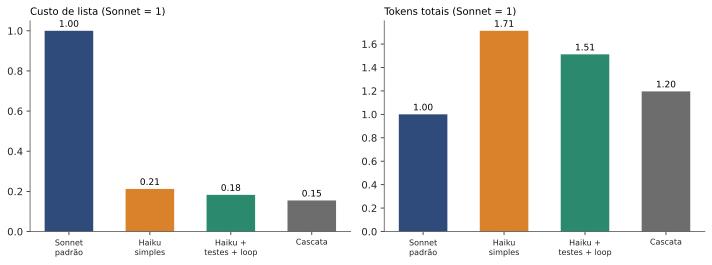
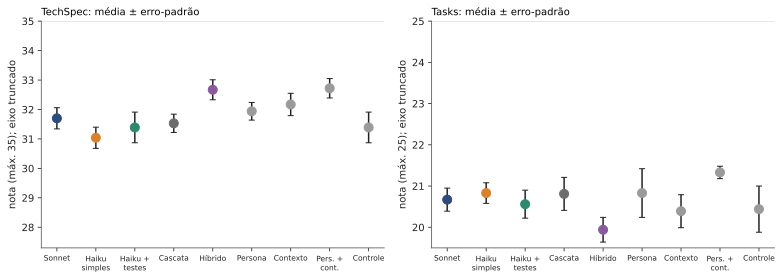
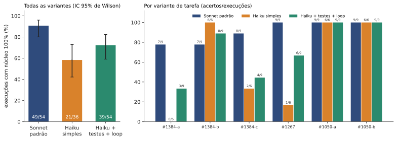

# SDD só com Haiku: o que sobra de qualidade quando o custo cai

**TL;DR.** Medi o Claude Haiku 5.5 contra o Sonnet 5.5 em desenvolvimento guiado por especificação (SDD: PRD, especificação técnica, tarefas e código) no projeto aberto h3, com 198 execuções isoladas. Por cerca de **1/5 do custo de lista** (0,18 do Sonnet), o Haiku escreve **TechSpec e Tasks com notas praticamente iguais** às do Sonnet, mas **acerta o código completo em 72% das execuções contra 91%** do Sonnet. A diferença no código vem de duas tarefas, e o estudo **não decide** se é um déficit pequeno ou grande. O instrumento de notas dos documentos ficou abaixo da confiabilidade que eu mesmo exigi, então nada disso é "confirmado".

## A dúvida

Cada etapa do SDD é um pedido a um modelo: escrever o PRD, a TechSpec, a lista de tarefas e, por fim, o código. Modelos pequenos custam uma fração dos grandes. A pergunta prática é: **dá para entregar o ciclo inteiro com o modelo pequeno e a engenharia certa em volta (testes primeiro, gates, loop de correção), sem perder muita qualidade?** Quase tudo que se lê sobre isso é opinião. Quis números, com as regras escritas antes. O desenho mais parecido que achei na literatura, de Rosa et al. (2026), é um registro de estudo sem resultados ainda.

## Hipóteses (resumo)

Escrevi 11 hipóteses antes de rodar qualquer coisa, com margens e regras de decisão (tag git `prereg-haiku-sdd-producao`, mais três adendos datados). As principais:

- **H1:** o Haiku simples fica pelo menos 3 pontos abaixo do Sonnet nos documentos.
- **H4:** com testes primeiro e loop de correção, o código do Haiku passa nos testes ocultos dentro de 10 pontos percentuais do Sonnet.
- **H5:** uma cascata (Haiku, escalando para o Sonnet se o gate reprova) mantém 90% da qualidade por no máximo 50% do custo.
- **H6:** descrever o custo e os tokens do Haiku com mitigações contra o Sonnet.
- **H11:** persona e contexto detalhado melhoram os documentos do Haiku.

Quatro delas (H2, H7, H8, H9) ficaram **fora deste estudo** por decisão minha: voto, erros plantados, cache e variações extras ficam para um próximo trabalho.

## Como medi

- **Projeto-alvo:** h3 (TypeScript), três features (#1267, #1384, #1050), seis variantes de tarefa, num commit fixo.
- **Condições:** C0 Sonnet padrão; C1 Haiku simples; C4 Haiku com testes primeiro e loop de correção com a saída do runner (a ideia vem de Mathews e Nagappan, 2024); C5 cascata (no espírito do FrugalGPT, de Chen, Zaharia e Zou, 2023); C6 híbrido (TechSpec pelo Sonnet); C2 e C2n (gate com loop e autorrevisão sem feedback, como controle, já que Huang et al., 2023, mostram que modelos corrigem mal o próprio raciocínio sem sinal externo); C10 a C13 (persona, contexto, os dois e um controle de tamanho).
- **Execução isolada:** cada etapa é um processo novo da CLI, numa pasta de nome opaco, sem histórico git nem remoto do projeto, com a web negada e as ferramentas restritas. A ordem das 198 execuções foi sorteada (uma semente fixa), uma por vez.
- **Código:** testes ocultos escritos por mim e cifrados, mais `typecheck` e `lint`. Uma execução só conta como boa com 100% do núcleo de testes esperado.
- **Documentos:** TechSpec (35 pontos) e Tasks (25) pontuadas por três juízes Opus isolados, às cegas, com códigos aleatórios (modelo como juiz, com os vieses descritos por Zheng et al., 2023). O `CLAUDE.md` e o `AGENTS.md` do h3 ficaram presentes em todas as condições, porque Gloaguen et al. (2026) mostram que arquivos de contexto do repositório podem mudar o resultado.
- **Custo:** consumo real em tokens e custo de lista medido pela própria ferramenta (preços de 04/11/2026: Haiku 5.5 a US$ 0,10 e US$ 0,50 por milhão de tokens até 100 mil de prompt, Sonnet 5.5 a US$ 2 e US$ 10).
- **Duas rodadas, as duas registradas antes dos dados:** 138 execuções planejadas e uma extensão de 60 (regra de parada de uma só rodada), com a análise primária e a estendida lado a lado.

Todo o código, os dados brutos, os prompts e as transcrições estão no repositório do estudo, e há um comando que reproduz as tabelas num clone limpo.

## Resultados

### Custo: o Haiku ganha de longe, mesmo gastando mais tokens

O Haiku com testes primeiro e loop (C4) custa **0,18 do Sonnet** em dólar de lista (IC 95%: 0,16 a 0,20). Em compensação, usa **1,5 vez** os tokens totais do Sonnet (1,39 a 1,64) e 1,55 vez os tokens novos. A cascata sai por 0,15. Em 52 das 54 execuções do C4 o prompt passou de 100 mil tokens, onde o preço do Haiku sobe; a ferramenta já cobra essa faixa, então a razão de 0,18 a inclui.

| Condição | Execuções | Custo de lista médio | Tokens totais médios |
|---|---|---|---|
| Sonnet padrão (C0) | 54 | US$ 1,23 | 2,41 mi |
| Haiku simples (C1) | 36 | US$ 0,26 | 4,13 mi |
| Haiku + testes + loop (C4) | 54 | US$ 0,22 | 3,64 mi |
| Cascata (C5) | 12 | US$ 0,19 | 2,88 mi |

### Documentos: praticamente empate, mas com instrumento frágil

Com 18 artefatos por braço e as três features, o Sonnet fica **0,7 ponto acima** do Haiku simples em TechSpec (IC 95%: −0,2 a +1,6, de 35) e **0,2 abaixo** em Tasks (−0,8 a +0,5, de 25). Longe dos 3 pontos que a H1 previa. A cascata fica em 0,99 e 1,01 da nota do Sonnet, a 0,15 do custo. **O ponto fraco:** o alfa de Krippendorff entre os juízes foi **0,61**, abaixo do 0,67 que eu tinha fixado, e as notas ficam coladas no teto (cerca de 32 de 35). Pela minha própria regra, as hipóteses de documentos saem **subpotentes**, e não confirmadas: o número é uma indicação de direção, não uma conclusão.

### Código: o ponto em que o Haiku ainda perde

O Sonnet passou o núcleo em 49 de 54 execuções (91%). O Haiku com testes primeiro e loop (C4) em 39 de 54 (72%), e o Haiku simples em 21 de 36 (58%). A diferença entre C4 e Sonnet é de **−18,5 pontos**, com intervalo de Newcombe unilateral de −32,6 a −3,8: é negativa com credibilidade, mas o intervalo **não exclui um déficit menor que os 10 pontos de margem**, então o status formal da H4 é "subpotente". Dizer "o Haiku equivale ao Sonnet em código" seria falso; dizer "perde por mais de 10 pontos" também.

O padrão é por tarefa, não geral:

| Variante | Sonnet | Haiku simples | Haiku + testes + loop |
|---|---|---|---|
| #1384-a | 7/9 | 0/6 | 3/9 |
| #1384-b | 7/9 | 6/6 | 8/9 |
| #1384-c | 8/9 | 2/6 | 4/9 |
| #1267 | 9/9 | 1/6 | 6/9 |
| #1050-a | 9/9 | 6/6 | 9/9 |
| #1050-b | 9/9 | 6/6 | 9/9 |

Nas duas variantes de #1050 todos chegam a 100%. A perda aparece em #1384-a, #1384-c e #1267. Se contarmos a fração de testes passando (incluindo os testes de observação), o quadro é menos duro: 0,89 para o C4 contra 0,91 para o Sonnet. As mitigações ajudam (de 58% no Haiku simples para 72%), mas não fecham a conta.

### O que não deu certo ou não deu para testar

- **Híbrido (H10):** pôr o Sonnet na TechSpec e o Haiku no resto custa **3,1 vezes** a cascata (2,5 a 4,0) sem ganho de nota. Refutada pelo critério de custo, que não depende da rubrica.
- **Cascata:** o gate reprovou só 3 de 234 documentos (1,3%), e a cascata **nunca escalou** para o Sonnet nas 12 execuções. Ela equivale ao Haiku com gates, e o escalonamento não foi testado (H3 e essa parte da H5 ficam "não testáveis neste desenho").
- **Persona e contexto (H11):** persona mais contexto juntos (C12) renderam cerca de +1,5 ponto em TechSpec e +1,1 em Tasks, com o controle de tamanho dentro do ruído. Sem correção para comparações múltiplas e com alfa baixo: um sinal para investigar, não um efeito provado.
- **Alucinações de citação (exploratório):** os artefatos do C4 trouxeram em média 0,42 citações inventadas por documento, contra 0,14 do Sonnet, em 12 documentos do C4 (6 execuções). Vale uma medição própria.

## O que isso significa na prática

- Para **escrever TechSpec e Tasks**, o Haiku parece estar muito perto do Sonnet por cerca de 1/5 do dólar. Eu o usaria, conferindo o resultado, e não trataria isso como garantia.
- Para **implementar código**, o Haiku com testes primeiro e loop acerta menos nas tarefas mais difíceis. Eu faria o Haiku escrever documentos e deixaria o código mais difícil para o Sonnet, ou escalaria para o Sonnet quando os testes falham. Esse desenho **não foi testado aqui**.
- O custo em tokens do Haiku é maior; o preço por token é que o torna barato. Em contextos acima de 100 mil tokens, a conta muda.

## Limitações

Um projeto (h3, TypeScript), três features e seis variantes; modelos e preços de 04/11/2026; juízes que são amostras do mesmo modelo (alfa 0,61); testes escritos por mim; o histórico git do estudo ainda guarda versões antigas dos testes em texto claro, fora do alcance do agente; a duração das execuções da extensão pode ter sido afetada por um juiz rodando em paralelo (tokens e custo não são afetados); a fase C (voto, erros plantados, cache) ficou de fora. As ameaças à validade completas estão no repositório.

## Conclusão

O Haiku 5.5 corta o custo para cerca de 1/5 e entrega documentos de SDD muito próximos aos do Sonnet, mas **ainda perde no código das tarefas mais difíceis**, e o estudo não consegue dizer se a perda é pequena ou grande. "SDD inteiro só com Haiku, sem perder qualidade" **não é o que os dados mostram**. O que eles mostram é um bom caso para o desenho híbrido (documentos no Haiku, código difícil no Sonnet), que fica para o próximo estudo.

## Referências

- Anthropic. *Pricing* (documentação da API), consultada em 04/11/2026. https://platform.claude.com/docs/en/about-claude/pricing
- Chen, Zaharia, Zou. *FrugalGPT: How to Use Large Language Models While Reducing Cost and Improving Performance.* arXiv:2305.05176, 2023.
- Mathews, Nagappan. *Test-Driven Development for Code Generation.* arXiv:2402.13521, 2024.
- Huang et al. *Large Language Models Cannot Self-Correct Reasoning Yet.* arXiv:2310.01798, 2023.
- Zheng et al. *Judging LLM-as-a-Judge with MT-Bench and Chatbot Arena.* arXiv:2306.05685, 2023.
- Gloaguen et al. *Evaluating AGENTS.md: Are Repository-Level Context Files Helpful for Coding Agents?* arXiv:2602.11988, 2026.
- Rosa et al. *Understanding Specification-Driven Code Generation with LLMs: An Empirical Study Design.* arXiv:2601.03878, 2026 (desenho de estudo, sem resultados).
- Dados, código e prompts do estudo: repositório `melolabs-dev/melolabs`, pasta `studies/haiku-sdd-producao`, tags `prereg-haiku-sdd-producao`, `-adendo1`, `-adendo2` e `-adendo2b`.
