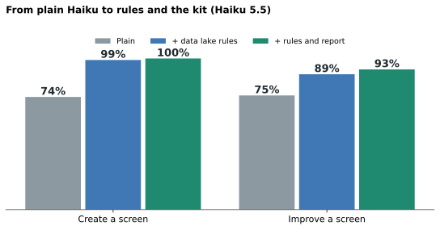
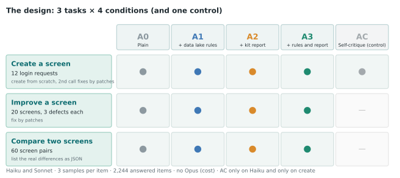
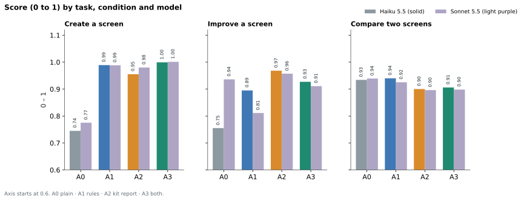
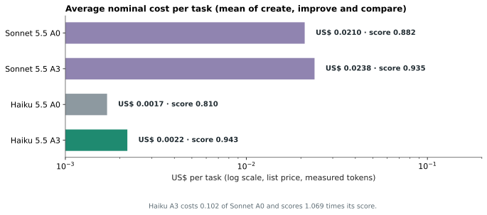
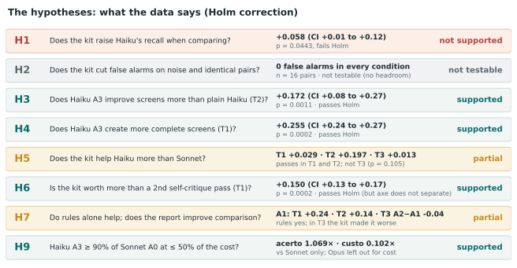
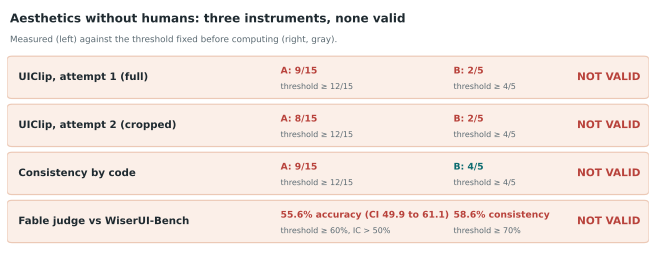
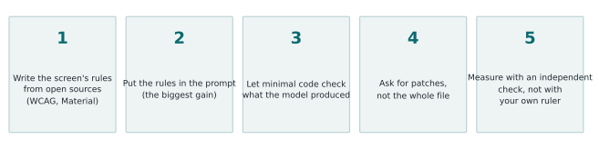

**The simple version of the "Haiku with a UX kit" study.** For the full method and every number, read the [technical article](/en/haiku-ui-design/). Here is what it means if you want to use it tomorrow.

## In one sentence

When Haiku (the small model) gets **open-source UX rules** and **a simple piece of code that checks the screen**, it creates and improves login screens **at the level of Sonnet (the larger model) working alone, for about 10% of the cost per task**. For comparing two screens, the code did not help. And **we could not measure aesthetics reliably without a person**.

## What we did

We picked **one small screen, the login screen**, and built three tasks: **create** the screen from scratch, **improve** a screen with hidden defects, and **compare** two screens by reading their code. To help Haiku we built:

- a **data lake of 30 rules** (contrast, labels on fields, button size, a password-recovery link and others), all taken from open sources (WCAG, web.dev, Material Design), none from memory;
- a small **code checker**, with no browser, that reads the HTML and CSS, says which rules fail and lists the real differences between two screens.

We ran **2,244 tasks** with Haiku and Sonnet, each 3 times, with no failures in the end. Before running, we wrote the hypotheses and the criteria.

## What we found

**1. The rules in the prompt already change a lot.** When **creating** a screen, Haiku alone met 74% of the rules; with the rules in the prompt, 99%. When **improving** a screen with defects, 75% rose to 89% with the rules alone, and to 97% with the checker report.

**2. The checker helps with improving and creating, and helps the small model more.** The gain was larger for Haiku than for Sonnet in creating and in improving. Sonnet alone already improves a screen well (94%) and even got worse when given the rules alone (81%).

**3. The combination costs a tenth.** On average per task, Haiku with rules and checker cost US$ 0.0022 and Sonnet alone US$ 0.0210, with Haiku's accuracy at 1.07 times Sonnet's.

**4. An independent tool confirmed part of it.** We ran the created screens through axe-core, an accessibility checker that neither our checker nor our prompts know: violations fell from 0.50 per screen (Haiku alone) to 0.03 (with rules and checker).

**5. Comparing two screens needed no help.** Given the code of both screens, Haiku and Sonnet already get about 93%, and the checker report **made it slightly worse** (to about 90%), mainly on CSS changes. Neither model invented a difference where there was none.

## What the hypotheses meant

Before running, we fixed the hypotheses and how much of a result would be enough. Of the confirmatory comparisons, 7 of 12 passed the multiple-testing correction:

- **Creating and improving with rules and checker:** yes, well above the baseline.
- **The checker helps Haiku more than Sonnet:** yes in creating and improving; no in comparing.
- **The checker is worth more than just a second self-critique pass (creating):** yes by our rules, but axe-core did not see that difference.
- **The checker reduces false alarms when comparing:** could not be tested, because nobody made mistakes on those pairs.
- **The main criterion (Haiku with the combination reaches 90% of Sonnet at up to half the cost):** **supported**, but only against Sonnet. Opus was left out of the study because of cost.

## What did not work, and what to be careful about

- **Aesthetics: no instrument without a human passed validation.** We tested a model trained on design ratings (UIClip), a set of code-based measures and a Fable pairwise judge against real A/B tests. Fable got 55.6% right (we needed 60%) and changed its answer when we swapped the order of the screens in 4 out of 10 cases. So **this study says nothing about beauty**.

- **The yardstick is the rules.** Creating and improving are scored by the same 30 rules we helped the model meet. axe-core softens this for creating, but not for improving. Read it as "Haiku meets the rules it is given", not as "Haiku does good UX".
- **One screen, script-generated screens, no Opus, no real browser in the checker.** We do not know whether it holds for real screens.

## The recipe

1. **Pick one small screen** and list the rules that matter, **from open sources only** (WCAG, official guides), never from memory.
2. **Put the rules in the small model's prompt.** That alone solves a good part of creating.
3. **Write a minimal checker** (reading HTML and CSS is enough for many rules) and hand its **report** to the model, asking for fixes as **patches**.
4. **Measure with a tool the model and the checker do not know**, such as axe-core, and be wary of scoring with the same rules you handed over.
5. **Do not measure aesthetics without a person.** If you have no designer, say you did not measure it.

All the code, stimuli and raw data are in the [study repository](/en/haiku-ui-design/), so you can check or repeat it.

---
*The experiments, data and conclusions are mine. The writing was AI-assisted and reviewed by me.*
