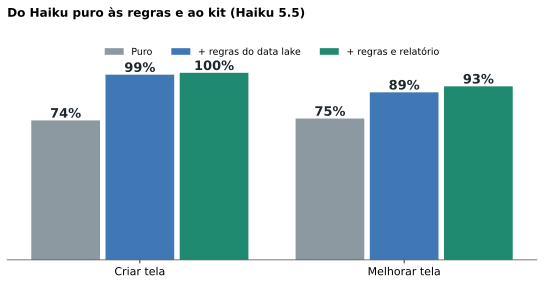
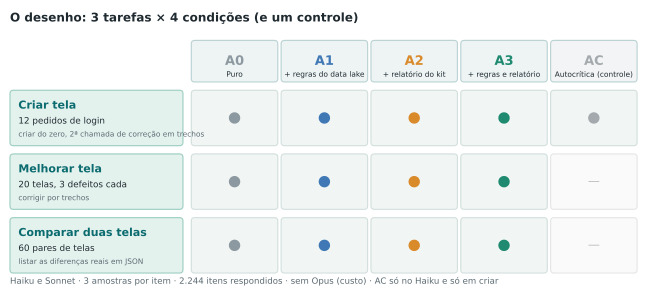
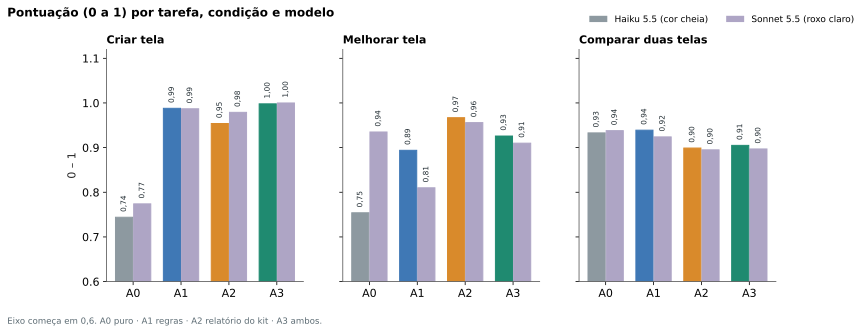
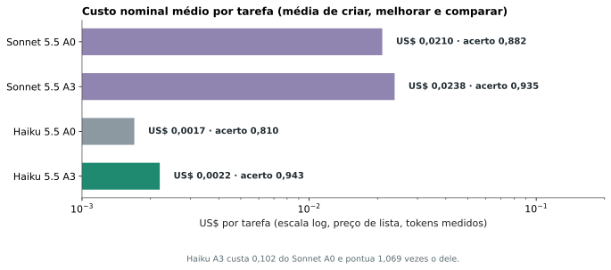
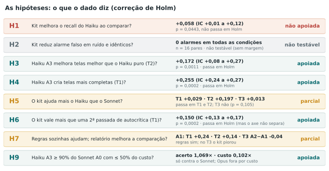
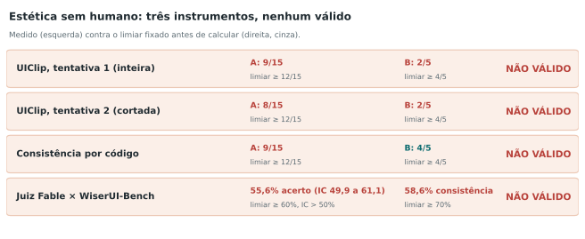
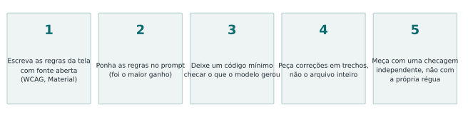

**Versão simples do estudo "Haiku com kit de UX".** Para o método completo e todos os números, leia o [artigo técnico](/pt/haiku-ui-design/). Aqui está o que ele significa para quem quer usar isso amanhã.

## Em uma frase

Quando o Haiku (o modelo pequeno) recebe **regras de UX com fonte aberta** e um **código simples que confere a tela**, ele cria e melhora telas de login **no nível do Sonnet (o modelo maior) sem ajuda, por cerca de 10% do custo por tarefa**. Em comparar duas telas, o código não ajudou. E **não conseguimos medir estética de forma confiável sem uma pessoa**.

## O que a gente fez

Escolhemos **uma tela pequena, a de login**, e criamos três tarefas: **criar** a tela do zero, **melhorar** uma tela com defeitos escondidos e **comparar** duas telas lendo o código. Para ajudar o Haiku, montamos:

- um **data lake de 30 regras** (contraste, rótulo nos campos, tamanho de botão, link de recuperar senha e outras), todas tiradas de fontes abertas (WCAG, web.dev, Material Design), nenhuma de cabeça;
- um **checador de código** pequeno, sem navegador, que lê o HTML e o CSS, diz quais regras falham e lista as diferenças reais entre duas telas.

Rodamos **2.244 tarefas** com Haiku e Sonnet, cada uma 3 vezes, sem nenhuma falha no final. Antes de rodar, escrevemos as hipóteses e os critérios.

## O que a gente descobriu

**1. As regras no prompt já mudam muito.** Ao **criar** uma tela, o Haiku sozinho cumpriu 74% das regras; com as regras no prompt, 99%. Ao **melhorar** uma tela com defeitos, de 75% para 89% só com regras, e para 97% com o relatório do checador.

**2. O checador ajuda a melhorar e a criar, e mais o modelo pequeno.** O ganho foi maior no Haiku que no Sonnet em criar e em melhorar. O Sonnet sozinho já melhora bem uma tela (94%) e até piorou quando recebeu só as regras (81%).

**3. O conjunto custa um décimo.** Em média por tarefa, o Haiku com regras e checador custou US$ 0,0022 e o Sonnet sozinho US$ 0,0210, com acurácia do Haiku 1,07 vez a do Sonnet.

**4. Uma ferramenta independente confirmou em parte.** Passamos as telas criadas pelo axe-core, um verificador de acessibilidade que o checador e os prompts não conhecem: as violações caíram de 0,50 por tela (Haiku sozinho) para 0,03 (com regras e checador).

**5. Comparar duas telas não precisou de ajuda.** Com o código das duas telas, Haiku e Sonnet já acertam cerca de 93%, e o relatório do checador **piorou um pouco** (para cerca de 90%), principalmente em mudanças de CSS. Nenhum dos dois inventou diferença onde não havia.

## O que as hipóteses queriam dizer

Antes de rodar, fixamos hipóteses e quanto de resultado bastaria. Das comparações confirmatórias, 7 de 12 passaram na correção de múltiplos testes:

- **Criar e melhorar com regras e checador:** sim, bem acima da linha de base.
- **O checador ajuda mais o Haiku que o Sonnet:** sim em criar e em melhorar; não em comparar.
- **O checador vale mais que só uma segunda passada de autocrítica (criar):** sim pelas nossas regras, mas o axe-core não viu essa diferença.
- **O checador reduz alarme falso ao comparar:** não deu para testar, porque ninguém errou nesses pares.
- **O critério principal (Haiku com o conjunto chega a 90% do Sonnet por até metade do custo):** **suportada**, mas só contra o Sonnet. O Opus ficou fora do estudo por custo.

## O que não funcionou, e o que fica de cuidado

- **Estética: nenhum instrumento sem humano passou na validação.** Testamos um modelo treinado em notas de design (UIClip), um conjunto de medidas por código e um juiz Fable em pares contra testes A/B reais. O Fable acertou 55,6% (precisávamos de 60%) e mudou de resposta ao trocar a ordem das telas em 4 de cada 10 vezes. Por isso, **este estudo não diz nada sobre beleza**.

- **A régua é a das regras.** Criar e melhorar são pontuados pelas mesmas 30 regras que ajudamos o modelo a cumprir. O axe-core ameniza isso em criar, mas não em melhorar. Leia como "o Haiku cumpre as regras dadas", não como "o Haiku faz bom UX".
- **Uma tela só, telas geradas por script, sem Opus, sem navegador real no checador.** Não sabemos se vale para telas reais.

## A receita

1. **Escolha uma tela pequena** e liste as regras que importam, **só de fontes abertas** (WCAG, guias oficiais), nunca de cabeça.
2. **Ponha as regras no prompt** do modelo pequeno. Só isso já resolve boa parte de criar.
3. **Escreva um checador mínimo** (ler HTML e CSS basta para muitas regras) e entregue o **relatório** ao modelo, pedindo correções em **trechos**.
4. **Meça com uma ferramenta que o modelo e o checador não conhecem**, como o axe-core, e desconfie de pontuar com as mesmas regras que você entregou.
5. **Não meça estética sem uma pessoa.** Se não tiver um designer, diga que não mediu.

Todo o código, os estímulos e os dados brutos estão no [repositório do estudo](/pt/haiku-ui-design/), para você conferir ou repetir.

---
*Os experimentos, os dados e as conclusões são meus. A redação foi assistida por IA e revisada por mim.*
