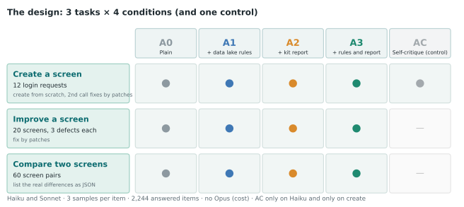
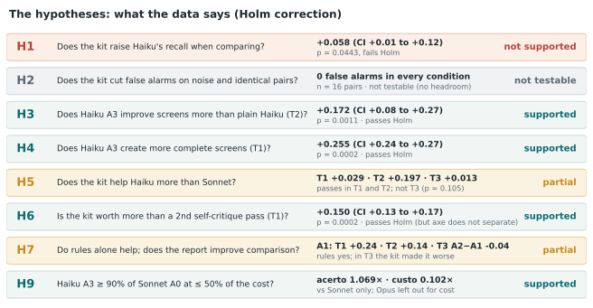
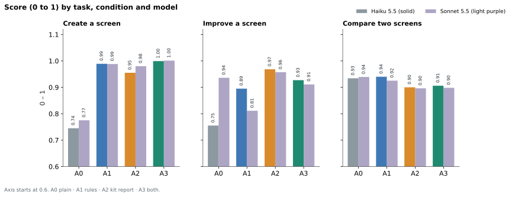
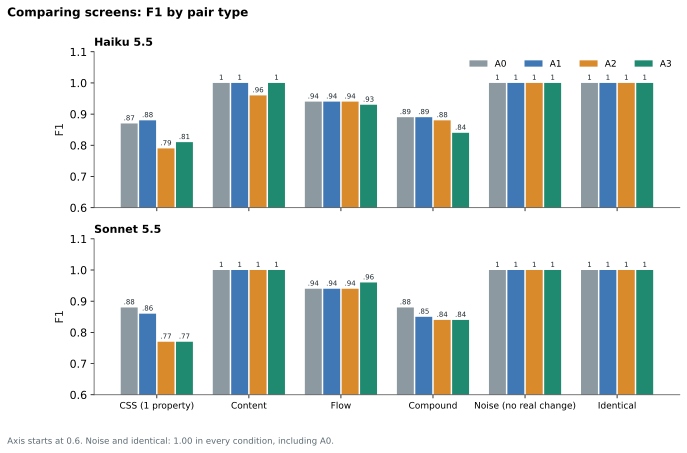
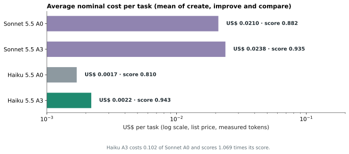
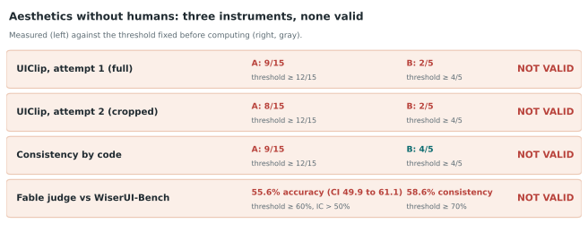
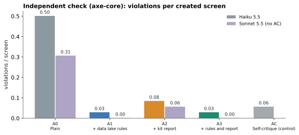

**Summary.** We tested whether the combination of a small model (Haiku 5.5), a UX rules data lake with open sources and a minimal checking code (the "kit") gets close to a larger model (Sonnet 5.5) on three login-screen tasks: creating, improving and comparing two screens at code level. There were 2,244 items and 2,424 calls, with 0 failures in the end. On creating and improving, Haiku with rules and kit went from 0.744 to 0.998 (create) and from 0.754 to 0.926 (improve), and **the combined accuracy of Haiku with the kit was 1.07 times that of plain Sonnet, at 10% of the cost per task**. On comparing two screens, the kit **did not help** and made things slightly worse; pairs with no real difference never produced a false alarm in any condition, so the hypothesis about false alarms could not be tested. Three non-human aesthetics instruments were validated and **none passed**; for that reason this study **claims nothing about beauty**. The main threat to validity is circular and is in section 9: the 30 rules the kit checks are the same ones that score create and improve. An independent check with axe-core confirms the gain in create, but not in improve. For the practical summary, there is the [simple guide](/en/haiku-ui-design-guia/).

## 1. The question and the decision it informs

In studies [1](/en/haiku-sdd-producao/) and [2](/en/rag-data-lake-haiku/), Haiku stayed close to larger models when it received the right process and context. What remains unknown is what happens in UX and UI, where two things tend to go wrong with language models: they perceive fine style differences poorly (the literature shows low recall in detecting CSS changes), and taste is subjective. The thesis of this study is that one can use **technology to cover what AI does poorly**: open-source rules in the prompt and code that checks and compares screens, leaving the model with what it does well, which is writing and fixing code.

**Study question:** does a Haiku with a UX rules data lake and a code-based checking kit get close to plain Sonnet in accuracy, and at what total cost? The unit under test is the whole (model + rules + kit), not the model alone. This matters: saying that "the code did the detection" is not a defect of the experiment; it is what is being measured.

## 2. The material

### 2.1 The login data lake

There are **30 rules** for a login screen, each with text, source, how to check it, a good example, a bad example, severity and type (25 objective, 5 semi-objective). All come from open, citable sources: WCAG 2.2 (contrast, labels, touch target, focus, reflow, language), web.dev (login form best practices) and Material Design 3 (consistency, hierarchy, spacing scale). No rule was written from memory as "truth". The source URLs were written from knowledge of the pages and **still need to be checked one by one by opening them** (pending item, section 9). Examples:

| Rule | Source | How it is checked |
|---|---|---|
| L08: button text with a contrast of at least 4.5:1 | WCAG 2.2, 1.4.3 | contrast ratio between the text color and the button background |
| L11: targets of at least 24 px (preferably 44) | WCAG 2.2, 2.5.8 | estimated height of button and fields |
| L17: link to recover the password | web.dev, WCAG 3.3.8 | an `<a>` exists with forgot/recover text |
| L28: fields and button with the same border radius | Material 3, text fields | compares `border-radius` |

### 2.2 The kit

The kit is minimal code, in Node, **with no browser and no layout** (degree 0 of a cost ladder): `parse5` for the HTML, `css-tree` for the CSS and `culori` for colors and contrast. It does two things: (a) it checks the 30 rules and returns a text report with what failed and where; (b) it compares two screens and lists the real differences in structure, content, flow and style, with normalized values (`#fff` equals `rgb(255,255,255)`, `16px` equals `1rem`; class names, whitespace, comments and attribute order are ignored). Each run takes about 0.6 s. We left the real browser (Playwright) and images out of the kit: what it does not see, for lack of layout, is declared in section 9.

### 2.3 The stimuli

All generated by a script with a fixed seed (20261110), which gives an exact answer key by construction and avoids screens the model may have seen in training.

- **T1, create (12 requests):** the same login screen for different contexts (clinic, bank, language school, chess club and others). Score: data lake rules met in the final HTML, out of 30.
- **T2, improve (20 screens):** each with 3 injected defects, from 22 types used (out of a catalog of 25), tied to rules. Score: defective rules removed minus new rules that start failing, divided by the injected rules.
- **T3, compare (60 pairs):** 20 CSS (13 large and 7 subtle, one property each), 8 content, 8 flow, 8 compound, 8 noise (changes with no effect: renaming classes, reformatting, color in another notation) and 8 identical. The answer is a JSON with the differences; the score is F1 against the answer key, and on noise and identical pairs it is 1 only if the model answers that there is no difference.

The generator checks the stimuli against the kit itself: the kit saw a difference in every pair with a change and in no noise or identical pair. This validates that the kit is consistent with the generator, **not** independent proof (section 9).

## 3. The conditions: what the model receives

| Condition | What the model receives | The question it answers |
|---|---|---|
| **A0** | only the task | how much does it do alone? (baseline) |
| **A1** | task + the 30 data lake rules | does knowledge alone, with no tool, help? |
| **A2** | task + kit report | does the tool alone, with no rules in the prompt, help? |
| **A3** | task + rules + report | the complete combination |
| **AC** (T1 only, Haiku only) | a second self-critique pass, without the kit | does the kit's gain come from information or only from an extra pass? |

In create, conditions A2, A3 and AC have two calls: generate the HTML and then fix it. In improve and compare, the report goes in the same prompt. Corrections come back as **patches** (`ANTES`/`DEPOIS`), applied by code equally to all models: 2,679 of 2,688 Haiku blocks and 2,358 of 2,359 Sonnet blocks were applied.

## 4. Design decisions

- **Models and execution:** Haiku 5.5 and Sonnet 5.5 through `claude -p` (subscription), with `--effort medium` and **no tools**, with a short system prompt identical for all. Without tools, the model **has no internet access** and cannot look up published labels: it only sees the prompt. Opus 5.5 was planned and **dropped for cost**, by the author's decision (deviation in section 9).
- **Nominal cost** = tokens × list price (per million tokens: Haiku US$ 0.10 input and 0.50 output; Sonnet US$ 2 and 10; cache read 0.01 and 0.10; cache write 1.25 times the input). The actual subscription spend is not billed in dollars.
- **Samples:** 3 per cell; each item enters the analysis through the mean of the 3.
- **Pilot:** 46 Haiku items tested the pipeline. After it we replaced the broken logo (an image with no file) with an embedded SVG, which changed the stimuli; for that reason the pilot is **not included** in the results.
- **Code, stimuli, lake and pre-registration** were frozen with SHA-256 hashes in `dados/CONGELADO.txt` before the run. There was no commit with a tag; the record is by hash (see section 9).

## 5. The execution

**2,244 items** ran (Haiku 1,140 and Sonnet 1,104, because AC exists only for Haiku), in **2,424 calls** (the two-call ones are create with A2, A3 and AC). Haiku consumed 4.68 million input tokens and 2.65 million output tokens; Sonnet, 4.54 million and 1.10 million. Notably, at the same medium effort, Haiku generated **more than twice as many output tokens** as Sonnet. The total nominal cost was **US$ 19.63** (Haiku US$ 1.69, Sonnet US$ 17.94). There was one error in the middle of the run, from the kit itself, and the item was redone: **final result, 0 items with errors**.

We recorded three deviations from the pre-registration, described in `dados/DESVIOS.md`: (1) the kit crashed on an invalid color generated by Haiku and was fixed without changing any rule or threshold; (2) Opus was dropped; (3) the logo was replaced before the run. None of them changes a hypothesis.

## 6. The hypotheses, one by one

Each hypothesis was written before the run, with a metric and a criterion. The p-values come from the paired Wilcoxon test over the items (means of the 3 samples), with a confidence interval by bootstrap over items (10,000 replicates) and Holm correction across the 12 confirmatory comparisons. Of these, **7 pass Holm**.

**H4: in create, does Haiku with rules and kit beat plain Haiku?** Yes: 0.998 versus 0.744, difference **+0.255** (95% CI: +0.239 to +0.274; p = 0.0002, passes Holm).

**H3: in improve, the same?** Yes: 0.926 versus 0.754, **+0.172** (95% CI: +0.083 to +0.267; p = 0.0011, passes). The new defects introduced fall from 0.53 to 0.18 per screen (p = 0.022, **does not pass** Holm).

**H7: do the rules alone already help?** Yes, in create (A1 0.988 versus 0.744, p = 0.0002) and in improve (0.894 versus 0.754, p = 0.0034). In compare, the tool (A2) came out **below** the rules-only condition (0.899 versus 0.939), the opposite of what was predicted.

**H6: is the kit's gain information or just an extra pass?** In create, the kit beats self-critique without the kit: 0.954 versus 0.804, **+0.150** (p = 0.0002, passes). The independent check with axe-core **does not confirm** this advantage (section 7.5).

**H5: does the kit help Haiku more than Sonnet?** In create, the gain of A3 over A0 is +0.255 for Haiku and +0.226 for Sonnet (difference +0.029; p = 0.002, passes); in improve, +0.172 versus −0.025 (difference +0.197; p = 0.0011, passes); in compare, no (p = 0.11). In improve, plain Sonnet is already good (0.935) and **gets worse** with the rules alone (0.810).

**H1: in compare, does the kit raise Haiku's recall?** Recall rises from 0.909 to 0.967 (+0.058; 95% CI: +0.005 to +0.121; p = 0.044), but **does not pass Holm**. Not supported.

**H2: does the kit reduce false alarms on pairs with no real difference?** **Not testable.** Haiku and Sonnet scored 1.00 on the 16 noise and identical pairs in every condition, including without the kit. There was no false alarm to reduce.

**H9: the main criterion.** Does Haiku with rules and kit reach at least 90% of the combined accuracy of plain Sonnet, at no more than 50% of the cost per task? The combined accuracy is the mean of the create, improve and compare scores. Result: **0.943 versus 0.882, ratio 1.07**, and mean cost per task of US$ 0.0022 versus US$ 0.0210, ratio **0.10**. **Supported**, but only against Sonnet: Opus was dropped, so there is no comparison with a larger model than that.

## 7. Results

| Task | Model | A0 | A1 | A2 | A3 | AC |
|---|---|---|---|---|---|---|
| T1 create | Haiku | 0.744 | 0.988 | 0.954 | 0.998 | 0.804 |
| T1 create | Sonnet | 0.774 | 0.987 | 0.979 | 1.000 | n.a. |
| T2 improve | Haiku | 0.754 | 0.894 | 0.967 | 0.926 | n.a. |
| T2 improve | Sonnet | 0.935 | 0.810 | 0.956 | 0.910 | n.a. |
| T3 compare | Haiku | 0.933 | 0.939 | 0.899 | 0.905 | n.a. |
| T3 compare | Sonnet | 0.938 | 0.924 | 0.895 | 0.897 | n.a. |

### 7.1 What worked

1. **The rules in the prompt already solve most of create.** Haiku goes from 0.744 to 0.988 with just the 30 rules (A1). The kit adds little there (A3 0.998).
2. **In improve, the kit report is what helps Haiku most:** from 0.754 (A0) to 0.967 (A2), above the rules alone (0.894), and with fewer new defects introduced.
3. **Haiku with the combination reaches the level of plain Sonnet, for a tenth of the cost.** The combined accuracy of Haiku A3 (0.943) is above that of Sonnet A0 (0.882), with US$ 0.0022 per task versus US$ 0.0210.
4. **Patch-based corrections work:** 99.7% of the Haiku blocks and 99.96% of the Sonnet blocks were applied without ambiguity.
5. **The response format was not a problem:** 100% of the compare JSONs were valid for both models.

### 7.2 What did not work

- **Comparing two screens at code level was already near the ceiling without help** (0.933 for plain Haiku, 0.938 for plain Sonnet), and the kit report **made things slightly worse**, especially in CSS: Haiku 0.87 (A0) versus 0.79 (A2) and 0.81 (A3), same pattern for Sonnet.

  The likely reason, not tested, is that the report lists several properties derived from a single change (for example, the four sides of a padding) and the model copies them; the answer key has one item, and the rest becomes a false alarm. It is a granularity failure of the kit and of the scoring together, and a rescoring that groups by property would be exploratory, done after seeing the data.
- **Noise and identical pairs discriminated nothing:** all got it right in every condition. This also says that, with the code of both screens in view, these models do not invent differences.
- **Sonnet got worse with the rules alone in improve** (0.935 to 0.810). We did not investigate the cause.

### 7.3 The cost

| Condition | Haiku (US$/task) | Sonnet (US$/task) |
|---|---|---|
| A0 | 0.0017 | 0.0210 |
| A1 | 0.0022 | 0.0241 |
| A2 | 0.0029 | 0.0359 |
| A3 | 0.0022 | 0.0238 |

The mean cost per task is the average of the three task types. Haiku A3 costs 10% of Sonnet A0. This figure is about tokens and **does not include the cost of building the kit and the data lake**, which was human and AI work and was not monetized; the break-even point against Sonnet depends on how many screens are checked with the same kit.

### 7.4 Aesthetics: no non-human instrument passed

The author is not a designer, and a human panel was ruled out. The way out was to look for instruments that are neither human nor from the family of the models under test and to **validate them before using them**, with criteria fixed before computing any score. Result: none validated.

- **UIClip** (a CMU/Apple model trained on ranked UIs): on 15 visually observable defects, the reference screen scored higher in only **9 of 15** (threshold 12) in attempt 1, and in **8 of 15** in attempt 2 (screen cropped to the content, the only extra attempt, declared). On graded degradation series, it followed only the button contrast and, at the exact limit (ρ = −0.8), the spacing between fields (**2 of 5** series in both attempts; threshold 4).
- **Consistency and hierarchy by code** (10 measures in Chrome): **9 of 15** on the defects and **4 of 5** on the series. It follows gradual degradation, but **does not see defects of absence** (removing the password recovery link made the score go up).
- **Fable judge in pairs**, validated against the 300 pairs of WiserUI-Bench (label: which variant won a real A/B test; 297 pairs with both images downloaded): **55.6% accuracy** (95% CI: 49.9 to 61.1; threshold 60% with a lower bound above 50%), and **position consistency of 58.6%** (threshold 70%). The same range the literature reports for AI judges against designers (mean agreement among the designers themselves: 62.4%).

Conclusion of this part: **without validity, aesthetics stays out of the decision and out of the conclusions**. The study measures legibility, consistency and conformity with open rules, which are part of UX, but not "beauty".

### 7.5 Independent check with axe-core

Since the 30 rules are both in the prompt and in the scoring of create and improve, we ran axe-core (WCAG 2.x A/AA), which the kit and the prompts do not know, on the final screens of T1 and T2. Mean violations per screen:

| T1 create | A0 | A1 | A2 | A3 | AC |
|---|---|---|---|---|---|
| Haiku | 0.50 | 0.03 | 0.08 | 0.03 | 0.06 |
| Sonnet | 0.31 | 0.00 | 0.06 | 0.00 | n.a. |

The gain in create **is confirmed** independently (Haiku A0 versus A3: p = 0.004). In improve, axe finds almost no violations in any condition, so it **does not discriminate**. And axe **does not confirm** the kit's advantage over self-critique without the kit (0.08 versus 0.06; p = 0.75): that part of H6 is supported only by the 30 rules themselves.

## 8. Why these results hold, and how far

The design has safeguards: hypotheses, metrics and parameters fixed before the run, with hashes; novel stimuli generated by script with an exact answer key; models without internet access; a self-critique control; multiple-testing correction; an independent check with another tool; reporting of deviations; reporting of negative results (compare, aesthetics) with the same rigor as the positive ones.

## 9. Threats to validity

- **Circularity (construct).** The 30 rules are in the prompt of A1 and A3 and the same kit generates the report of A2 and A3, but they are also what score create and improve. Haiku "learned the test". axe-core mitigates this in create and does not help in improve. The T1 and T2 numbers should be read as **conformity with the rules delivered**, not as general UX quality.
- **A single screen, synthetic screens.** Login, generated by script. No external validity for other screens or for real-world screens.
- **The kit was tuned on the noise types of this set,** and the same author wrote the stimuli and the kit. The "false alarm" result holds for those types and, in any case, was not testable.
- **The kit has no layout and no browser.** What depends on rendering (real alignment, overlap, line wrapping) is not seen. Degree 2 of the cost ladder was not built, nor was the image variant.
- **Opus was dropped for cost.** H5 and H9 compare only Haiku and Sonnet; nothing can be claimed about how close Haiku gets to the top of the model line.
- **No human panel and no valid aesthetics instrument.** The aesthetics result is negative and declared; the study does not measure beauty. The Fable judge was validated against conversion labels (which variant generated more actions), which are not beauty, and Fable may have seen WiserUI-Bench in training, which would inflate its accuracy (it did not pass even so).
- **The pre-registration is by hash, with no tag in the repository,** and was frozen before the main run, but after the pilot and the first test of the aesthetics instruments. The criteria for the aesthetics instruments were fixed before computing their scores, and there is a record that UIClip had two attempts.
- **The rule sources were opened, but not read one by one.** On 11/11/2026 I opened all 19 distinct WCAG, web.dev and Material Design URLs: 18 returned 200 and **1 returned 404** (Material Design 3, spacing, the source of rule L29). Opening a page does not prove it supports the rule; the support audit was done only in the following study.
- **Nominal cost** at list price, without the cost of building the kit and the data lake, and without the consumption of the plan limit.
- **The same family of models** wrote the study code (with the author) and was evaluated. The raw data are from real runs.

## 10. What this allows us to conclude

With confidence: on the tasks of creating and improving a login screen, giving Haiku the rules (and, in improve, the kit report) brings it to the level of unaided Sonnet, for about a tenth of the cost per task, as measured by the rules themselves and confirmed in create by an independent tool; on comparing two screens at code level, the kit's gain does not appear, because the models already get almost everything right, and the report can get in the way if it comes out verbose. Without confidence: whether the result holds for other screens, for real screens and for larger models; whether the advantage survives scoring that is independent of the rules; and any claim about aesthetics. Natural next steps: a third set of rules that the kit and the prompt do not know, to score with; a kit with layout (degree 2); Opus; and real screens.

## 11. Reproducibility

Code in `studies/haiku-ui-design/` (`kit/`, `gerador/`, `executor.py`); lake in `lake/login.json`; stimuli in `dados/estimulos/`; raw data in `dados/bruto/`; validation criteria for the aesthetics instruments and the judge in `dados/*CRITERIOS.md`; deviations in `dados/DESVIOS.md`; analysis with `python gerador/analise.py`; hashes in `dados/CONGELADO.txt`. The WiserUI-Bench images (CC BY-NC-SA 4.0, non-commercial research only) are **not** redistributed; the downloader `gerador/baixar_wiserui.py` fetches them from the original hosts. Archive DOI: **TODO: archive on Zenodo before publishing**.

## 12. References

- W3C. *Web Content Accessibility Guidelines (WCAG) 2.2*. https://www.w3.org/TR/WCAG22/
- web.dev. *Sign-in form best practices*. https://web.dev/articles/sign-in-form-best-practices
- Material Design 3. *Buttons, Text fields and Layout*. https://m3.material.io/
- DiffSpot: detection of CSS changes in screen pairs by multimodal models. arXiv:2605.29615.
- WiserUI-Bench: *Do MLLMs Capture How Interfaces Guide User Behavior?* arXiv:2505.05026 (data CC BY-NC-SA 4.0). https://github.com/jeochris/wiserui-bench
- DesignPref: *Capturing Personal Preferences in Visual Design Generation*. arXiv:2511.20513.
- Wu et al. *UIClip: A Data-driven Model for Assessing User Interface Design*. UIST 2024, arXiv:2404.12500.
- Reinecke et al. *Predicting users' first impressions of website aesthetics*. CHI 2013.
- Previous Melo Labs studies: [1](/en/haiku-sdd-producao/) and [2](/en/rag-data-lake-haiku/).

---
*The experiments, data and conclusions are mine. The writing was AI-assisted and reviewed by me.*
