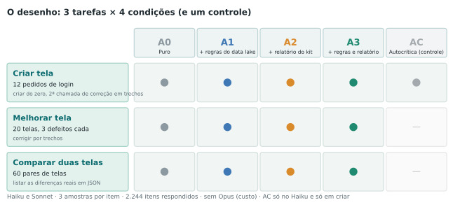
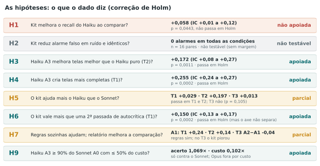
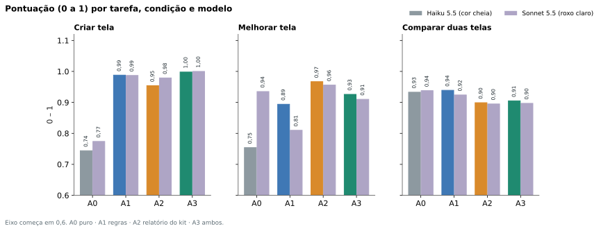
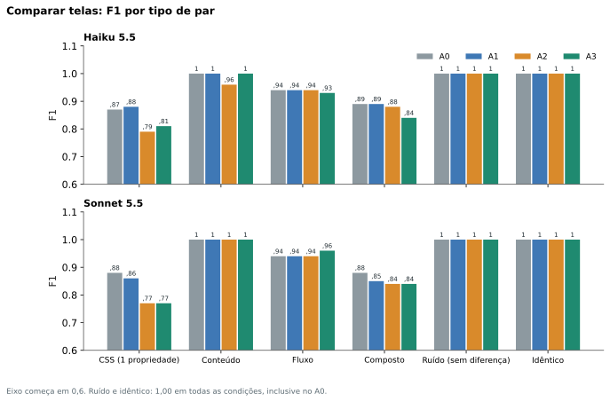
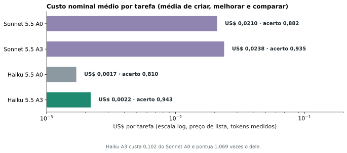
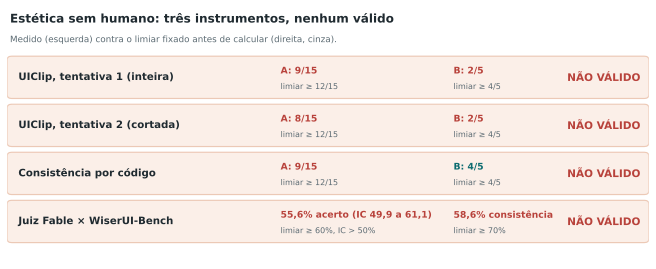
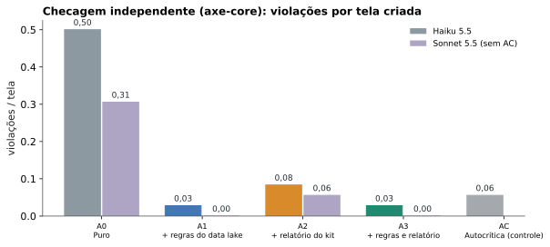

**Resumo.** Testamos se o conjunto formado por um modelo pequeno (Haiku 5.5), um data lake de regras de UX com fonte aberta e um código mínimo de checagem (o "kit") se aproxima de um modelo maior (Sonnet 5.5) em três tarefas de tela de login: criar, melhorar e comparar duas telas pelo código. Foram 2.244 itens e 2.424 chamadas, com 0 falhas no final. Em criar e melhorar, o Haiku com regras e kit passou de 0,744 para 0,998 (criar) e de 0,754 para 0,926 (melhorar), e a **acurácia combinada do Haiku com kit foi 1,07 vez a do Sonnet puro, a 10% do custo por tarefa**. Em comparar duas telas, o kit **não ajudou** e piorou um pouco; os pares sem diferença real nunca geraram alarme falso em nenhuma condição, então a hipótese sobre alarme falso não pôde ser testada. Três instrumentos de estética sem humano foram validados e **nenhum passou**; por isso este estudo **não afirma nada sobre beleza**. A principal ameaça à validade é circular e está na seção 9: as 30 regras que o kit verifica são as mesmas que pontuam criar e melhorar. Uma checagem independente com axe-core confirma o ganho em criar, mas não em melhorar. Para o resumo prático, existe o [guia simples](/pt/haiku-ui-design-guia/).

## 1. A pergunta e a decisão que ela informa

Nos estudos [1](/pt/haiku-sdd-producao/) e [2](/pt/rag-data-lake-haiku/), o Haiku ficou perto de modelos maiores quando recebeu processo e contexto certos. Falta saber o que acontece em UX e UI, onde duas coisas costumam dar errado com modelos de linguagem: eles percebem mal diferenças finas de estilo (a literatura mostra recall baixo em detectar mudanças de CSS), e o gosto é subjetivo. A tese deste estudo é que se pode usar **tecnologia para suprir o que a IA faz mal**: regras de fonte aberta no prompt e um código que checa e compara telas, deixando o modelo com o que ele faz bem, que é escrever e corrigir código.

**Pergunta do estudo:** um Haiku com um data lake de regras de UX e um kit de checagem por código chega perto do Sonnet puro em assertividade, e a que custo total? A unidade testada é o conjunto (modelo + regras + kit), não o modelo sozinho. Isso importa: dizer que "o código fez a detecção" não é um defeito do experimento; é o que está sendo medido.

## 2. O material

### 2.1 O data lake de login

São **30 regras** para uma tela de login, cada uma com texto, fonte, como checar, exemplo bom, exemplo ruim, severidade e o tipo (25 objetivas, 5 semi-objetivas). Todas vêm de fontes abertas e citáveis: WCAG 2.2 (contraste, rótulos, alvo de toque, foco, reflow, idioma), web.dev (boas práticas de formulário de login) e Material Design 3 (consistência, hierarquia, escala de espaçamento). Nenhuma regra foi escrita de memória como "verdade". As URLs das fontes foram escritas a partir do conhecimento das páginas e **ainda precisam de conferência de abertura uma a uma** (item pendente, seção 9). Exemplos:

| Regra | Fonte | Como se checa |
|---|---|---|
| L08: texto do botão com contraste de pelo menos 4,5:1 | WCAG 2.2, 1.4.3 | razão de contraste entre cor do texto e fundo do botão |
| L11: alvos de pelo menos 24 px (de preferência 44) | WCAG 2.2, 2.5.8 | altura estimada de botão e campos |
| L17: link para recuperar senha | web.dev, WCAG 3.3.8 | existe `<a>` com texto de esqueci/recuperar |
| L28: campos e botão com o mesmo raio de borda | Material 3, text fields | compara `border-radius` |

### 2.2 O kit

O kit é um código mínimo, em Node, **sem navegador e sem layout** (grau 0 de uma escada de custo): `parse5` para o HTML, `css-tree` para o CSS e `culori` para cores e contraste. Ele faz duas coisas: (a) verifica as 30 regras e devolve um relatório em texto com o que falhou e onde; (b) compara duas telas e lista as diferenças reais de estrutura, conteúdo, fluxo e estilo, com os valores normalizados (`#fff` igual a `rgb(255,255,255)`, `16px` igual a `1rem`; nomes de classe, espaços, comentários e ordem de atributos são ignorados). Cada execução leva cerca de 0,6 s. Deixamos o navegador real (Playwright) e a imagem de fora do kit: o que ele não enxerga, por não ter layout, é declarado na seção 9.

### 2.3 Os estímulos

Todos gerados por um script com semente fixa (20261110), o que dá gabarito exato por construção e evita telas que o modelo possa ter visto no treino.

- **T1, criar (12 pedidos):** a mesma tela de login para contextos diferentes (clínica, banco, escola de idiomas, clube de xadrez e outros). Pontuação: regras do data lake cumpridas no HTML final, de 30.
- **T2, melhorar (20 telas):** cada uma com 3 defeitos injetados, de 22 tipos usados (de um catálogo de 25), ligados a regras. Pontuação: regras defeituosas removidas menos regras novas que passam a falhar, dividido pelas regras injetadas.
- **T3, comparar (60 pares):** 20 de CSS (13 grandes e 7 sutis, de uma propriedade), 8 de conteúdo, 8 de fluxo, 8 compostos, 8 de ruído (mudanças sem efeito: renomear classes, reformatar, cor em outra notação) e 8 idênticos. A resposta é um JSON com as diferenças; a pontuação é F1 contra o gabarito, e nos pares de ruído e idênticos vale 1 só se o modelo responder que não há diferença.

O gerador confere os estímulos contra o próprio kit: o kit viu diferença em todos os pares com mudança e em nenhum par de ruído ou idêntico. Isso é uma validação de que o kit está coerente com o gerador, **não** uma prova independente (seção 9).

## 3. As condições: o que o modelo recebe

| Condição | O que o modelo recebe | A pergunta que responde |
|---|---|---|
| **A0** | só a tarefa | quanto ele faz sozinho? (linha de base) |
| **A1** | tarefa + as 30 regras do data lake | só o conhecimento, sem ferramenta, ajuda? |
| **A2** | tarefa + relatório do kit | só a ferramenta, sem regras no prompt, ajuda? |
| **A3** | tarefa + regras + relatório | o conjunto completo |
| **AC** (só T1, só Haiku) | uma segunda passada de autocrítica, sem o kit | o ganho do kit vem da informação ou só de uma passada extra? |

Em criar, as condições A2, A3 e AC têm duas chamadas: gerar o HTML e depois corrigir. Em melhorar e comparar, o relatório vai no mesmo prompt. As correções voltam em **trechos** (`ANTES`/`DEPOIS`), aplicados por código igualmente a todos os modelos: 2.679 de 2.688 blocos do Haiku e 2.358 de 2.359 do Sonnet foram aplicados.

## 4. Decisões de projeto

- **Modelos e execução:** Haiku 5.5 e Sonnet 5.5 por `claude -p` (assinatura), com `--effort medium` e **sem ferramentas**, com um prompt de sistema curto igual para todos. Sem ferramentas, o modelo **não acessa a internet** nem busca rótulos publicados: só vê o prompt. O Opus 5.5 estava previsto e **foi retirado por custo**, por decisão do autor (desvio na seção 9).
- **Custo nominal** = tokens × preço de lista (por milhão de tokens: Haiku US$ 0,10 de entrada e 0,50 de saída; Sonnet US$ 2 e 10; leitura de cache 0,01 e 0,10; escrita de cache 1,25 vez a entrada). O gasto real da assinatura não é cobrado em dólar.
- **Amostras:** 3 por célula; cada item entra na análise pela média das 3.
- **Piloto:** 46 itens do Haiku testaram o pipeline. Depois dele trocamos o logo quebrado (imagem sem arquivo) por um SVG embutido, o que mudou os estímulos; por isso o piloto **não entra** nos resultados.
- **Código, estímulos, lake e pré-registro** foram congelados com hashes SHA-256 em `dados/CONGELADO.txt` antes da rodada. Não houve commit com tag; o registro é por hash (ver seção 9).

## 5. A execução

Rodaram **2.244 itens** (Haiku 1.140 e Sonnet 1.104, porque o AC existe só no Haiku), em **2.424 chamadas** (as de duas chamadas são as de criar com A2, A3 e AC). O Haiku consumiu 4,68 milhões de tokens de entrada e 2,65 milhões de saída; o Sonnet, 4,54 milhões e 1,10 milhão. Notável: com o mesmo esforço médio, o Haiku gerou **mais que o dobro de tokens de saída** do Sonnet. O custo nominal total foi **US$ 19,63** (Haiku US$ 1,69, Sonnet US$ 17,94). Houve um erro no meio da rodada, do próprio kit, e o item foi refeito: **resultado final, 0 itens com erro**.

Registramos três desvios do pré-registro, descritos em `dados/DESVIOS.md`: (1) o kit travou numa cor inválida gerada pelo Haiku e foi corrigido sem mudar regra nem limiar; (2) o Opus foi retirado; (3) o logo foi trocado antes da rodada. Nenhum deles muda uma hipótese.

## 6. As hipóteses, uma a uma

Cada hipótese foi escrita antes da rodada, com métrica e critério. Os valores-p vêm do teste pareado de Wilcoxon sobre os itens (médias das 3 amostras), com intervalo de confiança por bootstrap de itens (10.000 réplicas) e correção de Holm nas 12 comparações confirmatórias. Dessas, **7 passam em Holm**.

**H4: no criar, o Haiku com regras e kit supera o Haiku puro?** Sim: 0,998 contra 0,744, diferença **+0,255** (IC 95%: +0,239 a +0,274; p = 0,0002, passa em Holm).

**H3: no melhorar, o mesmo?** Sim: 0,926 contra 0,754, **+0,172** (IC 95%: +0,083 a +0,267; p = 0,0011, passa). Os defeitos novos introduzidos caem de 0,53 para 0,18 por tela (p = 0,022, **não passa** em Holm).

**H7: regras sozinhas já ajudam?** Sim, em criar (A1 0,988 contra 0,744, p = 0,0002) e em melhorar (0,894 contra 0,754, p = 0,0034). Em comparar, a ferramenta (A2) ficou **abaixo** da condição só com regras (0,899 contra 0,939), o oposto do previsto.

**H6: o ganho do kit é informação ou só uma passada extra?** Em criar, o kit supera a autocrítica sem kit: 0,954 contra 0,804, **+0,150** (p = 0,0002, passa). A checagem independente com axe-core **não confirma** essa vantagem (seção 7.5).

**H5: o kit ajuda mais o Haiku que o Sonnet?** Em criar, o ganho de A3 sobre A0 é +0,255 no Haiku e +0,226 no Sonnet (diferença +0,029; p = 0,002, passa); em melhorar, +0,172 contra −0,025 (diferença +0,197; p = 0,0011, passa); em comparar, não (p = 0,11). Em melhorar, o Sonnet puro já é bom (0,935) e **piora** com as regras sozinhas (0,810).

**H1: em comparar, o kit aumenta o recall do Haiku?** O recall sobe de 0,909 para 0,967 (+0,058; IC 95%: +0,005 a +0,121; p = 0,044), mas **não passa em Holm**. Não apoiada.

**H2: o kit reduz alarme falso nos pares sem diferença real?** **Não testável.** Haiku e Sonnet tiveram nota 1,00 nos 16 pares de ruído e idênticos em todas as condições, inclusive sem kit. Não houve alarme falso para reduzir.

**H9: o critério principal.** O Haiku com regras e kit atinge pelo menos 90% da acurácia combinada do Sonnet puro, a no máximo 50% do custo por tarefa? A acurácia combinada é a média das pontuações de criar, melhorar e comparar. Resultado: **0,943 contra 0,882, razão 1,07**, e custo médio por tarefa de US$ 0,0022 contra US$ 0,0210, razão **0,10**. **Suportada**, mas só contra o Sonnet: o Opus foi retirado, então não há comparação com um modelo maior que ele.

## 7. Resultados

| Tarefa | Modelo | A0 | A1 | A2 | A3 | AC |
|---|---|---|---|---|---|---|
| T1 criar | Haiku | 0,744 | 0,988 | 0,954 | 0,998 | 0,804 |
| T1 criar | Sonnet | 0,774 | 0,987 | 0,979 | 1,000 | n.a. |
| T2 melhorar | Haiku | 0,754 | 0,894 | 0,967 | 0,926 | n.a. |
| T2 melhorar | Sonnet | 0,935 | 0,810 | 0,956 | 0,910 | n.a. |
| T3 comparar | Haiku | 0,933 | 0,939 | 0,899 | 0,905 | n.a. |
| T3 comparar | Sonnet | 0,938 | 0,924 | 0,895 | 0,897 | n.a. |

### 7.1 O que deu certo

1. **As regras no prompt já resolvem a maior parte de criar.** O Haiku vai de 0,744 para 0,988 só com as 30 regras (A1). O kit soma pouco ali (A3 0,998).
2. **Em melhorar, o relatório do kit é o que mais ajuda o Haiku:** de 0,754 (A0) para 0,967 (A2), acima das regras sozinhas (0,894), e com menos defeitos novos introduzidos.
3. **O Haiku com o conjunto fica no nível do Sonnet puro, por um décimo do custo.** A acurácia combinada do Haiku A3 (0,943) fica acima da do Sonnet A0 (0,882), com US$ 0,0022 por tarefa contra US$ 0,0210.
4. **As correções em trechos funcionam:** 99,7% dos blocos do Haiku e 99,96% dos do Sonnet foram aplicados sem ambiguidade.
5. **O formato de resposta não foi problema:** 100% dos JSON de comparar foram válidos nos dois modelos.

### 7.2 O que não funcionou

- **Comparar duas telas pelo código já estava perto do teto sem ajuda** (0,933 no Haiku puro, 0,938 no Sonnet puro), e o relatório do kit **piorou um pouco**, especialmente em CSS: Haiku 0,87 (A0) contra 0,79 (A2) e 0,81 (A3), mesmo padrão no Sonnet.

  O motivo provável, não testado, é que o relatório lista várias propriedades derivadas de uma só mudança (por exemplo, os quatro lados de um padding) e o modelo as copia; o gabarito tem um item, e o resto vira alarme falso. É uma falha de granularidade do kit e da pontuação juntas, e uma repontuação agrupando por propriedade seria exploratória, feita depois de ver os dados.
- **Pares de ruído e idênticos não discriminaram nada:** todos acertaram em todas as condições. Isso também diz que, com o código das duas telas à vista, esses modelos não inventam diferenças.
- **O Sonnet piorou com regras sozinhas em melhorar** (0,935 para 0,810). Não investigamos a causa.

### 7.3 O custo

| Condição | Haiku (US$/tarefa) | Sonnet (US$/tarefa) |
|---|---|---|
| A0 | 0,0017 | 0,0210 |
| A1 | 0,0022 | 0,0241 |
| A2 | 0,0029 | 0,0359 |
| A3 | 0,0022 | 0,0238 |

O custo médio por tarefa é a média dos três tipos de tarefa. O Haiku A3 custa 10% do Sonnet A0. Esse número é de tokens e **não inclui o custo de construir o kit e o data lake**, que foi trabalho humano e de IA e não foi monetizado; o ponto de equilíbrio contra o Sonnet depende de quantas telas se checam com o mesmo kit.

### 7.4 Estética: nenhum instrumento sem humano passou

O autor não é designer, e um painel humano foi descartado. A saída foi buscar instrumentos que não sejam humanos nem sejam da família dos modelos testados e **validá-los antes de usá-los**, com critérios fixados antes de calcular qualquer nota. Resultado: nenhum validou.

- **UIClip** (modelo da CMU/Apple treinado em UIs ranqueadas): em 15 defeitos visualmente observáveis, a tela de referência teve nota maior em apenas **9 de 15** (limiar 12) na tentativa 1, e em **8 de 15** na tentativa 2 (tela cortada no conteúdo, única tentativa extra, declarada). Em séries graduadas de degradação, acompanhou só o contraste do botão e, no limite exato (ρ = −0,8), o espaço entre campos (**2 de 5** séries nas duas tentativas; limiar 4).
- **Consistência e hierarquia por código** (10 medidas em Chrome): **9 de 15** nos defeitos e **4 de 5** nas séries. Acompanha a degradação gradual, mas **não vê defeitos de ausência** (remover o link de recuperar senha fez a nota subir).
- **Juiz Fable em pares**, validado contra os 300 pares do WiserUI-Bench (rótulo: qual variante venceu um teste A/B real; 297 pares com as duas imagens baixadas): **55,6% de acerto** (IC 95%: 49,9 a 61,1; limiar 60% com limite inferior acima de 50%), e **consistência de posição de 58,6%** (limiar 70%). Mesma faixa que a literatura reporta para juízes de IA contra designers (acordo médio entre os próprios designers: 62,4%).

Conclusão desta parte: **sem validade, a estética fica fora da decisão e fora das conclusões**. O estudo mede legibilidade, consistência e conformidade com regras abertas, que são parte do UX, mas não "beleza".

### 7.5 Checagem independente com axe-core

Como as 30 regras estão tanto no prompt quanto na pontuação de criar e melhorar, rodamos o axe-core (WCAG 2.x A/AA), que o kit e os prompts não conhecem, nas telas finais de T1 e T2. Violações médias por tela:

| T1 criar | A0 | A1 | A2 | A3 | AC |
|---|---|---|---|---|---|
| Haiku | 0,50 | 0,03 | 0,08 | 0,03 | 0,06 |
| Sonnet | 0,31 | 0,00 | 0,06 | 0,00 | n.a. |

O ganho de criar **se confirma** de forma independente (Haiku A0 contra A3: p = 0,004). Em melhorar o axe quase não acha violação em nenhuma condição, então **não discrimina**. E o axe **não confirma** a vantagem do kit sobre a autocrítica sem kit (0,08 contra 0,06; p = 0,75): essa parte de H6 só é sustentada pelas próprias 30 regras.

## 8. Por que esses resultados valem, e até onde

O desenho tem proteções: hipóteses, métricas e parâmetros fixados antes da rodada, com hashes; estímulos inéditos gerados por script com gabarito exato; modelos sem acesso à internet; controle de autocrítica; correção de múltiplos testes; checagem independente com outra ferramenta; relato dos desvios; relato dos resultados negativos (comparar, estética) com o mesmo rigor dos positivos.

## 9. Ameaças à validade

- **Circularidade (construto).** As 30 regras estão no prompt de A1 e A3 e o mesmo kit gera o relatório de A2 e A3, mas também são elas que pontuam criar e melhorar. O Haiku "aprendeu a prova". O axe-core ameniza em criar e não ajuda em melhorar. Os números de T1 e T2 devem ser lidos como **conformidade com as regras entregues**, não como qualidade geral de UX.
- **Uma tela só, telas sintéticas.** Login, gerado por script. Sem validade externa para outras telas ou para telas do mundo real.
- **O kit foi afinado nos tipos de ruído deste conjunto,** e o mesmo autor escreveu estímulos e kit. O resultado de "alarme falso" vale para esses tipos e, de toda forma, não foi testável.
- **O kit não tem layout nem navegador.** O que depende de renderização (alinhamento real, sobreposição, quebra de linha) não é visto. O grau 2 da escada de custo não foi construído, nem a variante com imagem.
- **O Opus foi retirado por custo.** H5 e H9 comparam só Haiku e Sonnet; não se pode afirmar nada sobre a proximidade do Haiku ao topo da linha de modelos.
- **Sem painel humano e sem instrumento válido de estética.** O resultado sobre estética é negativo e declarado; o estudo não mede beleza. O juiz Fable foi validado contra rótulos de conversão (qual variante gerou mais ações), que não são beleza, e o Fable pode ter visto o WiserUI-Bench no treino, o que inflaria a acurácia dele (ele nem assim passou).
- **O pré-registro é por hash, sem tag no repositório,** e foi congelado antes da rodada principal, mas depois do piloto e do primeiro teste dos instrumentos de estética. Os critérios dos instrumentos de estética foram fixados antes de calcular suas notas, e há registro de que o UIClip teve duas tentativas.
- **As fontes das regras foram abertas, mas não lidas uma a uma.** Em 11/11/2026 abri as 19 URLs distintas de WCAG, web.dev e Material Design: 18 responderam 200 e **1 respondeu 404** (Material Design 3, espaçamento, fonte da regra L29). Abrir a página não prova que ela sustenta a regra; a auditoria de sustentação foi feita só no estudo seguinte.
- **Custo nominal** de lista, sem o custo de montar o kit e o data lake, e sem o consumo do limite do plano.
- **Mesma família de modelos** escreveu o código do estudo (com o autor) e foi avaliada. Os dados brutos são de execuções reais.

## 10. O que isso permite concluir

Com segurança: em tarefas de criar e melhorar uma tela de login, dar ao Haiku as regras (e, em melhorar, o relatório do kit) o leva ao nível do Sonnet sem ajuda, por cerca de um décimo do custo por tarefa, medido pelas próprias regras e confirmado em criar por uma ferramenta independente; em comparar duas telas pelo código, o ganho do kit não aparece, porque os modelos já acertam quase tudo, e o relatório pode atrapalhar se vier verboso. Sem segurança: se o resultado vale para outras telas, para telas reais e para modelos maiores; se a vantagem sobrevive a uma pontuação independente das regras; e qualquer afirmação sobre estética. Próximos passos naturais: um terceiro conjunto de regras que o kit e o prompt não conhecem para pontuar; um kit com layout (grau 2); o Opus; e telas de verdade.

## 11. Reprodutibilidade

Código em `studies/haiku-ui-design/` (`kit/`, `gerador/`, `executor.py`); lake em `lake/login.json`; estímulos em `dados/estimulos/`; dados brutos em `dados/bruto/`; critérios de validação dos instrumentos de estética e do juiz em `dados/*CRITERIOS.md`; desvios em `dados/DESVIOS.md`; análise em `python gerador/analise.py`; hashes em `dados/CONGELADO.txt`. As imagens do WiserUI-Bench (CC BY-NC-SA 4.0, só pesquisa não comercial) **não** são redistribuídas; o baixador `gerador/baixar_wiserui.py` busca nos hosts originais. DOI do arquivamento: **TODO: arquivar no Zenodo antes de publicar**.

## 12. Referências

- W3C. *Web Content Accessibility Guidelines (WCAG) 2.2*. https://www.w3.org/TR/WCAG22/
- web.dev. *Sign-in form best practices*. https://web.dev/articles/sign-in-form-best-practices
- Material Design 3. *Buttons, Text fields e Layout*. https://m3.material.io/
- DiffSpot: detecção de mudanças de CSS em pares de telas por modelos multimodais. arXiv:2605.29615.
- WiserUI-Bench: *Do MLLMs Capture How Interfaces Guide User Behavior?* arXiv:2505.05026 (dados CC BY-NC-SA 4.0). https://github.com/jeochris/wiserui-bench
- DesignPref: *Capturing Personal Preferences in Visual Design Generation*. arXiv:2511.20513.
- Wu et al. *UIClip: A Data-driven Model for Assessing User Interface Design*. UIST 2024, arXiv:2404.12500.
- Reinecke et al. *Predicting users' first impressions of website aesthetics*. CHI 2013.
- Estudos anteriores do Melo Labs: [1](/pt/haiku-sdd-producao/) e [2](/pt/rag-data-lake-haiku/).

---
*Os experimentos, os dados e as conclusões são meus. A redação foi assistida por IA e revisada por mim.*
