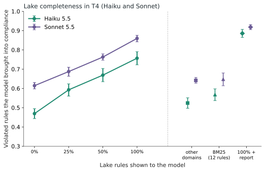

**The simple version of the study "How much does a UX data lake help a small model on big screens?".** For the full method and every number, read the [technical article](/en/haiku-ui-producao/). Here is what it means if you want to use it tomorrow.

## In one sentence

When the request is vague ("get this ready for production"), Haiku (the small model) fixed **46% of the issues with no rules, 70% with the whole set of 148 UX rules and 78% with the rules plus a verifier's report**. With the rules, it beat Sonnet (the larger model) without rules (61%) at **about 8% of the cost per call**.

## What we did

We built 6 kinds of big screen (dashboard, listing, form, checkout, settings and navigation, 383 to 1,200 lines) and a **data lake of 200 UX rules from open sources** (WCAG, GOV.UK, web.dev, Nielsen Norman and others), checked one by one against the source. On each screen we deliberately broke 3 to 30 rules. Then we asked Haiku and Sonnet to fix them, **showing 0%, 25%, 50% or 100% of the rules**, and measured with a verifier in a real browser how many rules came to be met. That was **2,640 calls**, and the hypotheses were written and frozen before running.

## What we found

1. **Every extra 25% of rules gave 8 to 12 more points of accuracy** on Haiku (47%, 59%, 67% and 76% on the rules shown). In practice: expanding the lake is worth it, and there is no sign it has reached its end.
2. **It is not just text volume.** Giving the same amount of rules from other subjects only raised accuracy from 47% to 52%. The right rule is what matters.
3. **The lake helped even where it did not cover.** On rules the model never saw, accuracy was up to 11 points higher with the full lake: the model became more careful overall.
4. **The verifier report avoids breaking what was already right.** It cut the rules that started failing from 0.94 to 0.21 per screen, and added to the full lake it raised accuracy from 70% to 78% (and from 76% to 89% on the rules shown).
5. **Better and cheaper.** Haiku with rules beat Sonnet without rules (70% against 61%) at US$ 0.0225 per call against US$ 0.2728, about 8% of the cost. On fixing screens with known defects, Haiku with rules reached 81% (against 63% for Sonnet without rules) at 6% of the cost.
6. **More rules, better-grounded decisions.** The share of Haiku's decisions citing a rule it actually received rose from 59% (25% of the lake) to 90% (full lake).

## What the study proved

We wrote the questions before running, and those that matter most to someone using the lake were confirmed, with statistical correction for multiple comparisons:

- **Completeness improves the decision:** 25%, 50% and 100% of the lake each gave higher accuracy than the previous step.
- **The right rule matters more than volume:** the full lake (76% on the rules shown) stayed far above the same amount of rules from other subjects (52%).
- **The lake does not hurt where it does not cover**, and the verifier report adds to the full lake and reduces regressions.
- **Cost:** the small model with the lake beats the larger model without it, at 6% to 8% of the cost per call.

Some things we tested did **not** work or did not apply (for example, how much of the lake simple search recovers). They are in section 6 of the [technical article](/en/haiku-ui-producao/).

## Caveats

- The screens are **synthetic** (six kinds, script-generated) and the task is **reviewing a draft**, not creating from scratch. That does not prove the same behavior in a large production project.
- We measured **rule compliance**, not whether the end user ended up better off.
- The verifier was wrong on about 13% of audited verdicts, and the lake was audited by a model, without human review.
- We tested only two models and **nothing about aesthetics**.

Want the data and method? [Read the technical article](/en/haiku-ui-producao/).

---
*The experiments, the data and the conclusions are mine. The writing was AI-assisted and reviewed by me.*
