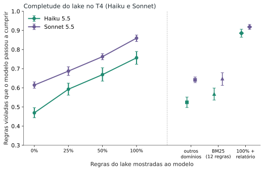

**Versão simples do estudo "O quanto o data lake de UX ajuda um modelo pequeno em telas grandes?".** Para o método completo e todos os números, leia o [artigo técnico](/pt/haiku-ui-producao/). Aqui está o que ele significa para quem quer usar isso amanhã.

## Em uma frase

Quando o pedido é vago ("deixa isso pronto para produção"), o Haiku (o modelo pequeno) acertou **46% das correções sem regras, 70% com o conjunto inteiro de 148 regras de UX e 78% com as regras mais o relatório de um verificador**. Com as regras, ele passou o Sonnet (o modelo maior) sem regras (61%), por **cerca de 8% do custo por chamada**.

## O que a gente fez

Montamos 6 tipos de tela grande (painel, listagem, formulário, checkout, configurações e navegação, de 383 a 1.200 linhas) e um **data lake de 200 regras de UX tiradas de fontes abertas** (WCAG, GOV.UK, web.dev, Nielsen Norman e outras), conferidas uma a uma contra a fonte. Em cada tela, estragamos de propósito de 3 a 30 regras. Depois pedimos ao Haiku e ao Sonnet que consertassem, **mostrando 0%, 25%, 50% ou 100% das regras**, e medimos com um verificador em navegador real quantas regras passaram a ser cumpridas. Foram **2.640 chamadas**, e as hipóteses foram escritas e congeladas antes de rodar.

## O que a gente descobriu

1. **Cada 25% a mais de regras rendeu de 8 a 12 pontos a mais de acerto** no Haiku (47%, 59%, 67% e 76% nas regras mostradas). Na prática: vale ampliar o lake, não há sinal de que ele já tenha chegado ao fim.
2. **Não é só volume de texto.** Dar o mesmo tanto de regras de outros assuntos subiu o acerto só de 47% para 52%. A regra certa é o que importa.
3. **O lake ajudou até onde ele não cobria.** Nas regras que o modelo nunca viu, o acerto foi até 11 pontos maior com o lake cheio: o modelo ficou mais cuidadoso no geral.
4. **O relatório do verificador evita quebrar o que já estava certo.** Ele cortou as regras que passaram a falhar de 0,94 para 0,21 por tela, e somado ao lake inteiro subiu o acerto de 70% para 78% (e de 76% para 89% nas regras mostradas).
5. **Melhor e mais barato.** O Haiku com regras passou o Sonnet sem regras (70% contra 61%) por US$ 0,0225 por chamada contra US$ 0,2728, cerca de 8% do custo. No conserto de telas com defeitos conhecidos, o Haiku com regras chegou a 81% (contra 63% do Sonnet sem regras) por 6% do custo.
6. **Mais regras, decisões mais ancoradas.** A fração das decisões do Haiku que citava uma regra realmente recebida subiu de 59% (25% do lake) para 90% (lake inteiro).

## O que o estudo comprovou

Escrevemos as perguntas antes de rodar, e as que mais importam para quem usa o lake foram confirmadas, com correção estatística para múltiplas comparações:

- **Completude melhora a decisão:** 25%, 50% e 100% do lake deram, cada um, acerto maior que o degrau anterior.
- **A regra certa pesa mais que o volume:** o lake inteiro (76% nas regras mostradas) ficou muito acima do mesmo tanto de regras de outros assuntos (52%).
- **O lake não prejudica onde não cobre**, e o relatório do verificador soma ao lake inteiro e reduz as regressões.
- **Custo:** o modelo pequeno com o lake passa o modelo maior sem ele, por 6% a 8% do custo por chamada.

Algumas coisas que testamos **não** deram certo ou não se aplicaram (por exemplo, o que uma busca simples recupera do lake). Elas estão na seção 6 do [artigo técnico](/pt/haiku-ui-producao/).

## Ressalvas

- As telas são **sintéticas** (seis tipos, geradas por script) e a tarefa é **revisar um rascunho**, não criar do zero. Isso não prova o mesmo comportamento em um projeto grande em produção.
- Medimos **conformidade com regras**, não se o usuário final ficou melhor.
- O verificador errou em cerca de 13% dos veredictos auditados, e o lake foi auditado por modelo, sem revisão humana.
- Só testamos dois modelos e **nada sobre estética**.

Quer os dados e o método? [Leia o artigo técnico](/pt/haiku-ui-producao/).

---
*Os experimentos, os dados e as conclusões são meus. A redação foi assistida por IA e revisada por mim.*
