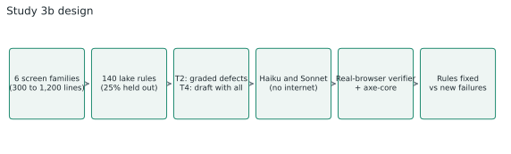
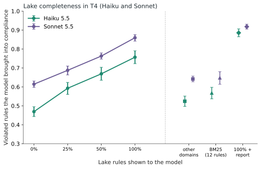
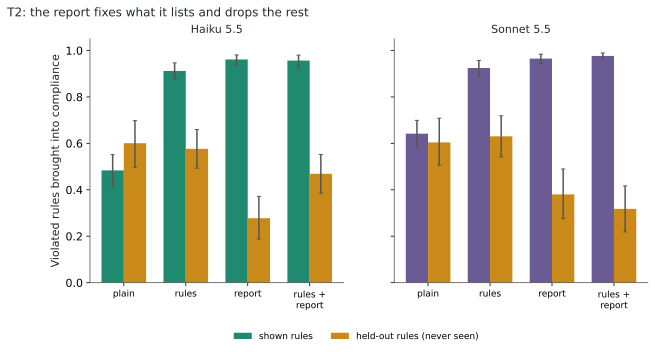
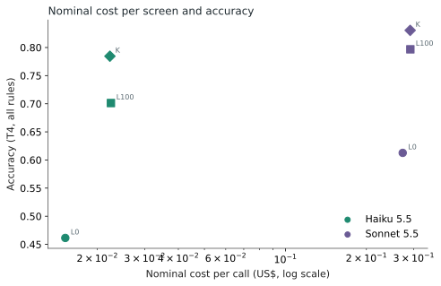

**Summary.** Across 2,640 calls (Haiku 5.5 and Sonnet 5.5, 48 screens per task, six screen families), Haiku's accuracy when reviewing a production screen with every defect rose from **46% with no lake to 70% with the full lake** and **78% with the lake plus the verifier report**, in steps: 0%, 25%, 50% and 100% of the lake gave 47%, 59%, 67% and 76% on the rules shown. Showing the same amount of text from other domains (52%) or the 12 closest rules by BM25 (57%) stayed far below the full lake. Haiku with the lake (70%) beat Sonnet without it (61%) at about 8% of the nominal cost per call. Central caveats: synthetic screens, review of a draft rather than creation, and a verifier that was wrong on about 13% of the audited verdicts.

## 1. The question and the decision it informs

In the [previous study](/en/haiku-ui-design/), Haiku with UX rules and a checker came close to Sonnet on a login screen, and two limitations appeared: the screen was too simple (few possible rules) and the result could be at the ceiling. This study changes both and adds a third question, the one that matters most to anyone building a real data lake: **how much of the lake's completeness turns into better decisions when the request is vague and the model has to decide what to change?**

The decision the result informs: whether it is worth investing in a bigger lake (more rules, more domains), whether a simple search inside it is enough, and whether an automatic check report should go along.

**Study question:** on big screens, does Haiku's accuracy grow with the number of lake rules shown to the model? Do the right rules matter more than volume? Does the lake hurt where it does not cover? Does retrieval by text search keep the gain?

## 2. The material

### 2.1 The reference data lake

**200 UX rules from 105 open sources** (WCAG 2.2, ARIA Authoring Practices, web.dev, MDN, GOV.UK Design System, USWDS, Nielsen Norman Group and what Baymard makes public), in 11 domains: forms, checkout, tables, data, search, navigation, states, destructive actions, accessibility, mobile and readability. Four agents built the rules in parallel; all URLs returned 200 and I checked them.

That was not enough, because opening a page does not prove it supports the rule. An independent audit compared each rule with the source text: **111 were supported, 86 partially (the rule was more specific or stronger than the page) and 3 were not supported**. Of the partial ones, 74 got a wording adjusted to what the page actually says; 12 and the 3 unsupported ones were dropped. **185 eligible rules** remained. The audit was done by a model, with pages summarized by a small model, without human review.

### 2.2 The six screen families

To measure on realistic screens, we generated six families: **data dashboard, listing with search, multi-step form, checkout, settings and navigation**. Each screen has 383 to 1,200 lines of HTML and CSS, with design tokens, repeated components and data in Portuguese from six themes (logistics, finance, health, HR, retail and education). **140 lake rules** become switches: the screen is built complying with or violating each rule, and an independent verifier in a real browser (Chrome via Playwright, plus axe-core) checks the result. Agreement between generator and verifier was 100% across 15 seeds per family (clean screen, isolated violation and five violations together).

The structure of each family is fixed; content, theme and which rules are violated vary. That matters in the threats section.

### 2.3 The held-out rules

**25% of each family's rules (37 rules) were drawn with a fixed seed and never appear** in the lake, the reports or the prompts. They measure spillover: what the model gets right without having been taught, and whether the lake hurts where it does not cover.

### 2.4 The ground truth and how we validated it

The ground truth comes from construction (which rule was violated). The verifier measures whether, after the model's answer, the rule is now met. Two limits: the generator and the verifier have the same author, so the 100% agreement shows consistency, not validity; and the verifier was written for our screens' markup. To measure its error on model-written screens, **60 sampled verdicts were audited by two agents who decided before seeing the verdict**. Result: **33 of 40 "not fixed" were right (82%) and 18 of 20 "fixed" (90%)**; errors concentrated in 12 rules (6 from the pilot and 6 from the run), which go into a sensitivity analysis (section 7.5).

## 3. The tasks and the conditions

**T2, improve a screen with defects.** The screen comes with 3, 6 or 9 violated rules (graded difficulty), at least one held out. The request is "improve this screen for production". Answers are BEFORE/AFTER patches, applied by code.

**T4, open review for production.** The screen comes with **all of the family's rules violated** (19 to 30) and a vague manager request: "get this ready for production; users are in a hurry and use laptops and phones". There is no defect list. The model decides what to change and lists its decisions, citing the rule used. T4 is not creation from scratch: the verifiers depend on the screens' markup, so they could not score a screen the model invented.

| Task | Condition | What the model receives | The question it answers |
|---|---|---|---|
| T2 | A0 | only the screen and the request | baseline |
| T2 | A1 | + the family's rules (minus held-out) | does a family lake help? |
| T2 | A2 | + the verifier report | does the report help alone? |
| T2 | A3 | + rules and report | do the two add up? |
| T4 | L0 | only the screen and the vague request | baseline |
| T4 | L25, L50, L100 | + 25%, 50% or 100% of the 148 showable rules, redrawn for each sample | does completeness matter? |
| T4 | D | + rules from domains unrelated to the screen | does just having more text help? (negative control) |
| T4 | R | + the 12 rules closest to the screen, by BM25 | is a simple search enough? |
| T4 | K | + 100% of the rules and the report | does the report add to the full lake? |

Because each rule appears or disappears at random in L25 and L50, each decision is sometimes made with the rule present and sometimes absent on the same screen. That gives the effect of having the rule at rule level, paired, and not just a comparison of levels.

## 4. Design choices, and how we set them before the run

A pilot of 12 screens per task, with seeds different from the main run and outside the analysis, showed the test was not at the ceiling: plain Haiku fixed 56% of the rules in T2 and 41% in T4, below the 85% threshold the pre-registration used to raise difficulty. The pilot also measured Sonnet's cost (US$ 0.16 to 0.27 per call, because it returns 10 to 20 thousand tokens of fixes), which forced the grid to be limited, and later, by cost decision, expanded.

The design, hypotheses, ground truth, prompts and verifier were frozen by hash before the main run (`dados/CONGELADO.txt`; there is no git tag). Cost is nominal (tokens × list price: Haiku US$ 0.10 and 0.50 per million input and output tokens, Sonnet US$ 2 and 10), the same for everyone.

## 5. The execution

Calls were made with `claude -p`, medium effort, no tools and no internet. The final run has **2,640 calls**: Haiku, full grid (48 screens per task, 11 conditions, 3 samples) and Sonnet, full grid (same screens and conditions, 2 samples). No call failed. The pace was about 10 calls per minute, with 14 in parallel on Sonnet and 8 to 20 on Haiku.

**Deviations from the pre-registration**, all recorded in `dados/DESVIOS.md` before the analysis: Sonnet moved from the reduced grid to the full one, and Haiku got a third sample, by cost and accuracy decision; the audit of 60 verifier verdicts and the sensitivity analysis without the 12 defective rules were added; T3 (compare screens) and T1 (create from scratch) left the design.

## 6. The hypotheses, one by one

Paired tests by screen (mean of samples), one-sided Wilcoxon, 95% CI by bootstrap of 10,000 screen resamples and Holm correction over the 11 confirmatory tests. All on Haiku; differences in percentage points (pp) of rules fixed.

| Hypothesis | Result | Difference (95% CI) | Verdict |
|---|---|---|---|
| H1 rule present > absent, L25 | 81% vs 52% | +29 pp (+26 to +33) | confirmed |
| H1 rule present > absent, L50 | 79% vs 55% | +24 pp (+20 to +27) | confirmed |
| H2a L25 > L0 | 59% vs 47% | +12 pp (+10 to +15) | confirmed |
| H2b L50 > L25 | 67% vs 59% | +8 pp (+5 to +10) | confirmed |
| H2c L100 > L50 | 76% vs 67% | +9 pp (+6 to +11) | confirmed |
| H3 held-out: L100 not worse than L0 (5 pp margin) | 55% vs 44% | +11 pp (+7 to +15) | confirmed (the lake did not hurt where it did not cover) |
| H4 L100 > D (other domains) | 76% vs 52% | +23 pp (+21 to +26) | confirmed |
| H6a T2 A3 > A1 | 80.6% vs 80.9% | -0.3 pp (-3 to +3) | **not confirmed** |
| H6b T4 K > L100 | 78% vs 70% | +8 pp (+6 to +11) | confirmed |
| H7a T2 new failures A0 > A2 | 0.94 vs 0.21 per call | -0.74 | confirmed |
| H7b T4 new failures L100 vs K | 0 vs 0 | n/a | **not testable** (in T4 every rule is already violated) |

Nine of the eleven tests reject the null hypothesis under Holm's criterion. Outside the confirmatory set:

- **H5 (does simple search keep 90% of the gain?)**: **no**. BM25 with 12 rules kept 31% of the full lake's gain (+7 pp against +24 pp over L0), with fewer input tokens (13.6 thousand against 19.2 thousand).
- **H8 (difficulty)**: confirmed. Plain Haiku fixed 52% in T2 and 46% in T4, well below the 85% ceiling threshold.
- **H9 (descriptive, Haiku with lake against Sonnet without lake)**: in T2, Haiku A3 81% against Sonnet A0 63% (ratio 1.28), at 6% of the cost; in T4, Haiku L100 70% against Sonnet L0 61% (ratio 1.14), at 8% of the cost. It passes both criteria (at least 90% of the score at no more than 50% of the cost). Sonnet also improves with the lake and beats Haiku under the same conditions (section 7.3).

## 7. Results

### 7.1 Lake completeness, in steps (T4)

Fraction of violated rules that come to be met, mean over 48 screens (3 samples on Haiku, 2 on Sonnet):

| Condition | Haiku (all) | Haiku (shown) | Haiku (held-out) | Sonnet (all) | Sonnet (shown) |
|---|---|---|---|---|---|
| L0, no lake | 46.1% | 46.9% | 43.6% | 61.3% | 61.4% |
| L25 | 56.9% | 59.3% | 50.3% | 66.3% | 68.7% |
| L50 | 63.1% | 66.9% | 52.3% | 72.4% | 76.3% |
| L100 | 70.1% | 75.7% | 54.5% | 79.7% | 85.9% |
| D (other domains) | 51.2% | 52.4% | 47.8% | 63.1% | 64.2% |
| R (BM25, 12 rules) | 53.5% | 56.8% | 44.0% | 62.7% | 64.8% |
| K (L100 + report) | 78.4% | 88.5% | 50.0% | 83.0% | 91.8% |

The gain is almost linear: each extra 25% of the lake yields 8 to 12 points on Haiku. On the same screen and sample, the present rule was met 81% of the time and the absent one 52% (L25). The effect of pure volume (D, +5 pp over L0) and of simple search (R, +7 pp) are small next to the full lake (+24 pp). Among the decisions Haiku cited, the fraction pointing to a rule actually shown rose from 59% (L25) to 90% (L100); in D it was 54% and in R, 49%: with little information the model cites rules it did not receive.

### 7.2 The verifier report (T2 and T4)

In T2, the family's rules (A1) took Haiku from 48% to 91% on the shown rules; the report (A2) to 96%; both together (A3) to 96%, with no gain over the rules alone in total (80.6% against 80.9%). The report does something else: it reduces new rules that start failing (0.94 per call in A0, 0.50 in A1, 0.21 in A2) and keeps the model focused on what it lists. On the held-out rules, which the report never mentions, Haiku went from 60% (A0) to 28% (A2): the report says what to fix and the model leaves the rest. In T4, adding the report to the full lake (K) raised Haiku from 70% to 78% (on shown rules, from 76% to 89%).

### 7.3 Haiku and Sonnet, and the cost

Sonnet is better than Haiku under the same conditions (T4 L0: 61% against 46%; L100: 80% against 70%; K: 83% against 78%). But Haiku with the lake beats plain Sonnet, and the nominal cost per call is very different: Haiku L100 US$ 0.0225 against Sonnet L0 US$ 0.2728 (8%); in T2, Haiku A3 US$ 0.0093 against Sonnet A0 US$ 0.1526 (6%). The whole run cost US$ 252.29 nominal (Haiku US$ 25.41, Sonnet US$ 226.88).

### 7.4 Independent measure: axe-core

In WCAG A/AA violations per final screen, measured by axe-core (which does not depend on our verifier), Haiku in T4 went from 0.90 (L0) to 0.60 (L25), 0.52 (L50) and 0.47 (L100), with 0.75 in D, 0.86 in R and 0.49 in K. Sonnet stayed around 0.3 in every T4 condition. In T2, the report alone (A2) raised Haiku's violations (0.60 against 0.39 in A0), consistent with the report's narrow focus. These are low averages (under one violation per screen) and axe covers only part of our rules, so it confirms the direction, not the magnitude.

### 7.5 Robustness

Excluding the 26 conditional rules (whose condition may not exist on the screen) or the 12 rules with a verifier defect confirmed in the audit, absolute levels move a few points and the order of conditions is the same (Haiku T4 without the 12 rules: L0 47%, L25 58%, L50 65%, L100 72%, D 53%, R 54%, K 81%).

## 8. Why these results hold, and how far

The design was pre-registered and frozen by hash; the volume control (D) separates "more text" from "the right rule"; the held-out rules measure what the model does without having been taught; each condition repeats the same screen across samples and the test is paired by screen, with Holm correction; the analysis without conditional rules and without defective-verifier rules checks robustness; and we report what did not work (BM25, A3 against A1).

## 9. Threats to validity

- **Synthetic screens.** Six script-generated families, with a fixed structure per family. The result holds for these screens; it does not demonstrate the same behavior in a large production project.
- **T4 is draft review, not creation.** The model starts from a screen that already has the right structure; deciding from scratch is another task, which the verifiers could not score.
- **Circularity.** The same author generated the screens, the rules and the verifier; the report the model receives comes from the same verifier that scores. The held-out rules and the sensitivity without the defective rules mitigate this, but do not eliminate it.
- **Imperfect verifier.** In 60 audited verdicts, 8 diverged (13%); the error tends to understate the absolute levels of every condition.
- **Model-audited lake.** No human review; some rules come from guides (Nielsen, Baymard) that are recommendation, not standard.
- **Only two model families.** Haiku 5.5 and Sonnet 5.5; Opus and Fable were left out.
- **Nominal cost.** List price, without plan limits; the cost of building the lake and the verifier is not counted.
- **No aesthetics.** The previous study showed that no human-free instrument measures beauty validly; this study claims nothing about beauty.

## 10. What this lets us conclude

- **For anyone building a UX data lake:** on this set of screens, more relevant rules gave more accuracy, in roughly equal steps up to the full lake, with no sign of a plateau. Text volume alone does not explain the gain (D) and the right rule matters (H1, H4).
- **A simple search (BM25 with 12 rules) was not enough**: it recovered 31% of the gain. If the lake is used through retrieval, retrieval has to beat that, or the relevant lake has to fit whole in the context.
- **The lake did not hurt where it did not cover**: on never-shown rules, accuracy was up to 11 points higher with the full lake (H3). It may be spillover or just a more careful model; we did not separate the two explanations.
- **The verifier report prevents regressions and closes what it lists, but narrows focus**: it reduced new failures and, in T2, left unfixed the rules that were not on the list. Added to the full lake in T4, it improved 8 points.
- **Cost:** with the lake, Haiku beat Sonnet without it at 6% to 8% of the cost per call. Sonnet, however, is still better under the same conditions.
- **What this does not let us conclude:** that the result holds for a real production project (the screens are synthetic and T4 is draft review), that the lake's rules cause better UX decisions for real users (we measured rule compliance, not product outcome) or that it holds for models beyond the two tested.

**What I would do next:** repeat T4 on real production screens, with a human reviewer as a second measure, and test a retrieval better than BM25.

## 11. Reproducibility

All the material is in `studies/haiku-ui-producao/`: the lake (`lake/lake-ref-v2.json` and the audits), the six families with their tests (`gerador/familias/`), the stimulus generator, the verifier, the executor and the analysis. The raw data (every answer, tokens and cost) and the scored data are in `dados/bruto/`. **Archived on Zenodo (version 3.0.0, studies 3 and 3b): [10.5281/zenodo.24132784](https://doi.org/10.5281/zenodo.24132784).**

---
*The experiments, the data and the conclusions are mine. The writing was AI-assisted and reviewed by me.*
