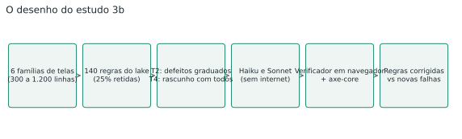
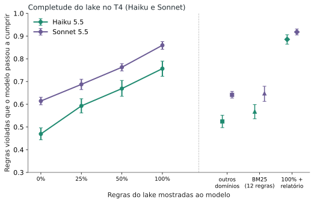
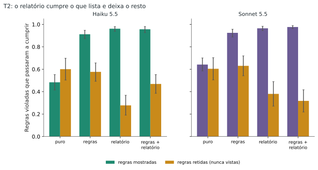
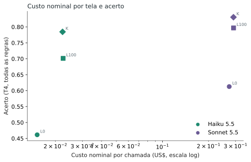

**Resumo.** Em 2.640 chamadas (Haiku 5.5 e Sonnet 5.5, 48 telas por tarefa, seis famílias de tela), o acerto do Haiku ao revisar uma tela de produção com todos os defeitos subiu de **46% sem lake para 70% com o lake inteiro** e **78% com o lake e o relatório do verificador**, em degraus: 0%, 25%, 50% e 100% do lake deram 47%, 59%, 67% e 76% nas regras mostradas. Mostrar o mesmo volume de texto de outros domínios (52%) ou as 12 regras mais próximas por BM25 (57%) ficou muito abaixo do lake inteiro. O Haiku com lake (70%) superou o Sonnet sem lake (61%) a cerca de 8% do custo nominal por chamada. Ressalvas centrais: telas sintéticas, revisão de rascunho e não criação, e um verificador que errou em cerca de 13% dos veredictos auditados.

## 1. A pergunta e a decisão que ela informa

No [estudo anterior](/pt/haiku-ui-design/), o Haiku com regras de UX e um checador chegou perto do Sonnet em uma tela de login, e apareceram duas limitações: a tela era simples demais (poucas regras possíveis) e o resultado podia ser ceiling. Este estudo mexe nas duas e acrescenta uma terceira pergunta, a que mais interessa a quem monta um data lake de verdade: **quanto da completude do lake vira decisão melhor quando o pedido é vago e o modelo precisa decidir o que mudar?**

A decisão que o resultado informa: se vale a pena investir em ampliar o lake (mais regras, mais domínios), se uma busca simples dentro dele basta, e se um relatório de checagem automática deve ir junto.

**Pergunta do estudo:** em telas grandes, o acerto do Haiku cresce com a quantidade de regras do lake mostradas ao modelo? As regras certas importam mais que o volume? O lake atrapalha onde não cobre? A recuperação por busca de texto mantém o ganho?

## 2. O material

### 2.1 O data lake de referência

São **200 regras de UX, de 105 fontes abertas** (WCAG 2.2, ARIA Authoring Practices, web.dev, MDN, GOV.UK Design System, USWDS, Nielsen Norman Group e o que é público do Baymard), em 11 domínios: formulários, checkout, tabelas, dados, busca, navegação, estados, ações destrutivas, acessibilidade, mobile e legibilidade. Quatro agentes montaram as regras em paralelo; todas as URLs responderam 200 e foram conferidas por mim.

Isso não bastava, porque abrir a página não prova que ela sustenta a regra. Uma auditoria independente comparou cada regra com o texto da fonte: **111 foram sustentadas, 86 parcialmente (a regra era mais específica ou mais forte que a página) e 3 não foram sustentadas**. Das parciais, 74 ganharam uma redação ajustada ao que a página realmente diz; 12 e as 3 não sustentadas saíram. Ficaram **185 regras elegíveis**. A auditoria foi feita por modelo, com páginas resumidas por modelo pequeno, sem revisão humana.

### 2.2 As seis famílias de telas

Para medir em telas realistas, geramos seis famílias: **painel de dados, listagem com busca, formulário em várias etapas, checkout, configurações e navegação**. Cada tela tem de 383 a 1.200 linhas de HTML e CSS, com tokens de design, componentes repetidos e dados em português de seis temas (logística, finanças, saúde, RH, varejo e educação). **140 regras do lake** viram interruptores: a tela é construída cumprindo ou violando cada uma, e um verificador independente, em navegador real (Chrome via Playwright e o axe-core), confere o resultado. A concordância entre gerador e verificador foi de 100% em 15 sementes por família (tela limpa, violação isolada e cinco violações juntas).

A estrutura de cada família é fixa; variam conteúdo, tema e quais regras estão violadas. Isso importa na seção de ameaças.

### 2.3 As regras retidas

**25% das regras de cada família (37 regras) foram sorteadas com semente fixa e nunca aparecem** no lake, nos relatórios nem nos prompts. Elas medem o transbordamento: o que o modelo acerta sem ter sido ensinado, e se o lake atrapalha onde não cobre.

### 2.4 O gabarito e como o validamos

O gabarito vem da construção (qual regra foi violada). O verificador mede se, depois da resposta do modelo, a regra passou a ser cumprida. Dois limites: o gerador e o verificador têm o mesmo autor, então a concordância de 100% mostra consistência, não validade; e o verificador foi escrito para a marcação das nossas telas. Para medir o erro dele nas telas escritas pelo modelo, **60 veredictos sorteados foram auditados por dois agentes que decidiram antes de ver o veredito**. Resultado: **33 de 40 "não corrigido" estavam certos (82%) e 18 de 20 "corrigido" (90%)**; os erros se concentraram em 12 regras (6 do piloto e 6 da rodada), que entram numa análise de sensibilidade (seção 6).

## 3. As tarefas e as condições

**T2, melhorar uma tela com defeitos.** A tela vem com 3, 6 ou 9 regras violadas (dificuldade graduada), ao menos uma retida. O pedido é "melhore esta tela para produção". As respostas são trechos ANTES/DEPOIS, aplicados por código.

**T4, revisão aberta para produção.** A tela vem com **todas as regras da família violadas** (de 19 a 30) e um pedido vago do gerente: "deixa isso pronto para entrar em produção; os usuários têm pressa e usam notebook e celular". Não há lista de defeitos. O modelo decide o que mudar e lista as decisões, citando a regra usada. O T4 não é criação do zero: os verificadores dependem da marcação das telas, então não pontuariam uma tela inventada pelo modelo.

| Tarefa | Condição | O que o modelo recebe | A pergunta que ela responde |
|---|---|---|---|
| T2 | A0 | só a tela e o pedido | linha de base |
| T2 | A1 | + regras da família (sem as retidas) | o lake de uma família ajuda? |
| T2 | A2 | + relatório do verificador | o relatório ajuda sozinho? |
| T2 | A3 | + regras e relatório | os dois somam? |
| T4 | L0 | só a tela e o pedido vago | linha de base |
| T4 | L25, L50, L100 | + 25%, 50% ou 100% das 148 regras mostráveis, sorteadas de novo a cada amostra | a completude importa? |
| T4 | D | + regras de domínios que não têm a ver com a tela | só ter mais texto ajuda? (controle negativo) |
| T4 | R | + as 12 regras mais próximas da tela, por BM25 | uma busca simples basta? |
| T4 | K | + 100% das regras e o relatório | o relatório soma ao lake cheio? |

Como cada regra aparece ou some de forma aleatória em L25 e L50, cada decisão fica às vezes com a regra presente e às vezes ausente na mesma tela. Isso dá o efeito de ter a regra no nível da regra, pareado, e não só de comparar níveis.

## 4. As escolhas de projeto, e como as definimos antes da rodada

Um piloto de 12 telas por tarefa, com sementes diferentes das da rodada principal e fora da análise, mostrou que o teste não estava no teto: o Haiku sem ajuda corrigiu 56% das regras no T2 e 41% no T4, abaixo do limiar de 85% que o pré-registro usava para aumentar a dificuldade. O piloto também mediu o custo do Sonnet (US$ 0,16 a 0,27 por chamada, porque ele devolve de 10 mil a 20 mil tokens de correção), o que forçou a grade a ser limitada, e depois, por decisão de custo, ampliada.

O desenho, as hipóteses, o gabarito, os prompts e o verificador foram congelados por hash antes da rodada principal (`dados/CONGELADO.txt`; não há tag no git). O custo é nominal (tokens × preço de tabela: Haiku US$ 0,10 e 0,50 por milhão de tokens de entrada e saída, Sonnet US$ 2 e 10), igual para todos.

## 5. A execução

As chamadas foram feitas com `claude -p`, esforço médio, sem ferramentas e sem internet. A rodada final tem **2.640 chamadas**: Haiku, grade completa (48 telas por tarefa, 11 condições, 3 amostras) e Sonnet, grade completa (as mesmas telas e condições, 2 amostras). Nenhuma chamada falhou. O ritmo foi de cerca de 10 chamadas por minuto, com 14 em paralelo no Sonnet e de 8 a 20 no Haiku.

**Desvios do pré-registro**, todos registrados em `dados/DESVIOS.md` antes da análise: o Sonnet saiu da grade reduzida e foi para a completa, e o Haiku ganhou a terceira amostra, por decisão de custo e de assertividade; a auditoria de 60 veredictos do verificador e a análise de sensibilidade sem as 12 regras defeituosas foram acrescentadas; T3 (comparar telas) e T1 (criar do zero) saíram do desenho.

## 6. As hipóteses, uma a uma

Testes pareados por tela (média das amostras), Wilcoxon unilateral, IC95 por bootstrap de 10.000 reamostras de telas e correção de Holm sobre os 11 testes confirmatórios. Todos no Haiku; diferenças em pontos percentuais (pp) de regras corrigidas.

| Hipótese | Resultado | Diferença (IC95) | Veredito |
|---|---|---|---|
| H1 regra presente > ausente, L25 | 81% vs 52% | +29 pp (+26 a +33) | confirmada |
| H1 regra presente > ausente, L50 | 79% vs 55% | +24 pp (+20 a +27) | confirmada |
| H2a L25 > L0 | 59% vs 47% | +12 pp (+10 a +15) | confirmada |
| H2b L50 > L25 | 67% vs 59% | +8 pp (+5 a +10) | confirmada |
| H2c L100 > L50 | 76% vs 67% | +9 pp (+6 a +11) | confirmada |
| H3 retidas: L100 não pior que L0 (margem 5 pp) | 55% vs 44% | +11 pp (+7 a +15) | confirmada (o lake não atrapalhou onde não cobria) |
| H4 L100 > D (outros domínios) | 76% vs 52% | +23 pp (+21 a +26) | confirmada |
| H6a T2 A3 > A1 | 80,6% vs 80,9% | -0,3 pp (-3 a +3) | **não confirmada** |
| H6b T4 K > L100 | 78% vs 70% | +8 pp (+6 a +11) | confirmada |
| H7a T2 regras novas A0 > A2 | 0,94 vs 0,21 por chamada | -0,74 | confirmada |
| H7b T4 regras novas L100 vs K | 0 vs 0 | n/a | **não testável** (no T4 todas as regras já estão violadas) |

Nove dos onze testes rejeitam a hipótese nula pelo critério de Holm. Fora do conjunto confirmatório:

- **H5 (a busca simples mantém 90% do ganho?)**: **não**. O BM25 com 12 regras manteve 31% do ganho do lake inteiro (+7 pp contra +24 pp sobre L0), com menos tokens de entrada (13,6 mil contra 19,2 mil).
- **H8 (dificuldade)**: confirmada. O Haiku puro corrigiu 52% no T2 e 46% no T4, bem abaixo dos 85% do limiar de teto.
- **H9 (descritiva, Haiku com lake contra Sonnet sem lake)**: no T2, Haiku A3 81% contra Sonnet A0 63% (razão 1,28), com 6% do custo; no T4, Haiku L100 70% contra Sonnet L0 61% (razão 1,14), com 8% do custo. Passa os dois critérios (pelo menos 90% da pontuação com no máximo 50% do custo). O Sonnet também melhora com o lake e supera o Haiku nas mesmas condições (seção 7.3).

## 7. Resultados

### 7.1 A completude do lake, em degraus (T4)

Fração das regras violadas que passam a cumprir, média sobre 48 telas (3 amostras no Haiku, 2 no Sonnet):

| Condição | Haiku (todas) | Haiku (mostradas) | Haiku (retidas) | Sonnet (todas) | Sonnet (mostradas) |
|---|---|---|---|---|---|
| L0, sem lake | 46,1% | 46,9% | 43,6% | 61,3% | 61,4% |
| L25 | 56,9% | 59,3% | 50,3% | 66,3% | 68,7% |
| L50 | 63,1% | 66,9% | 52,3% | 72,4% | 76,3% |
| L100 | 70,1% | 75,7% | 54,5% | 79,7% | 85,9% |
| D (outros domínios) | 51,2% | 52,4% | 47,8% | 63,1% | 64,2% |
| R (BM25, 12 regras) | 53,5% | 56,8% | 44,0% | 62,7% | 64,8% |
| K (L100 + relatório) | 78,4% | 88,5% | 50,0% | 83,0% | 91,8% |

O ganho é quase linear: cada 25% a mais de lake rende de 8 a 12 pontos no Haiku. Dentro da mesma tela e amostra, a regra presente foi cumprida em 81% das vezes e a ausente em 52% (L25). O efeito do volume puro (D, +5 pp sobre L0) e o da busca simples (R, +7 pp) são pequenos perto do lake completo (+24 pp). Entre as decisões que o Haiku citou, a fração que aponta para uma regra realmente mostrada subiu de 59% (L25) para 90% (L100); em D foi 54% e em R, 49%: com pouca informação o modelo cita regras que não recebeu.

### 7.2 O relatório do verificador (T2 e T4)

No T2, as regras da família (A1) levaram o Haiku de 48% para 91% nas regras mostradas; o relatório (A2) a 96%; os dois juntos (A3) a 96%, sem ganho sobre as regras sozinhas no total (80,6% contra 80,9%). O relatório faz outra coisa: reduz as regras novas que passam a falhar (0,94 por chamada em A0, 0,50 em A1, 0,21 em A2) e deixa o modelo focado no que ele lista. Nas regras retidas, que o relatório nunca menciona, o Haiku foi de 60% (A0) a 28% (A2): o relatório diz o que corrigir e o modelo deixa o resto. No T4, o relatório somado ao lake inteiro (K) subiu o Haiku de 70% para 78% (nas regras mostradas, de 76% para 89%).

### 7.3 Haiku e Sonnet, e o custo

O Sonnet é melhor que o Haiku nas mesmas condições (T4 L0: 61% contra 46%; L100: 80% contra 70%; K: 83% contra 78%). Mas o Haiku com lake supera o Sonnet puro, e o custo nominal por chamada é muito diferente: Haiku L100 US$ 0,0225 contra Sonnet L0 US$ 0,2728 (8%); no T2, Haiku A3 US$ 0,0093 contra Sonnet A0 US$ 0,1526 (6%). A rodada inteira custou US$ 252,29 nominais (Haiku US$ 25,41, Sonnet US$ 226,88).

### 7.4 Medida independente: axe-core

Em violações WCAG A/AA por tela final, medidas pelo axe-core (que não depende do nosso verificador), o Haiku no T4 foi de 0,90 (L0) para 0,60 (L25), 0,52 (L50) e 0,47 (L100), com 0,75 em D, 0,86 em R e 0,49 em K. O Sonnet ficou em torno de 0,3 em todas as condições do T4. No T2, o relatório sozinho (A2) elevou as violações do Haiku (0,60 contra 0,39 em A0), coerente com o foco estreito do relatório. São médias baixas (menos de uma violação por tela) e o axe cobre só parte das nossas regras, então ele confirma a direção, não a magnitude.

### 7.5 Robustez

Excluindo as 26 regras condicionais (cuja condição pode não existir na tela) ou as 12 regras com defeito de verificador confirmado em auditoria, os níveis absolutos mudam poucos pontos e a ordem das condições é a mesma (Haiku T4 sem as 12 regras: L0 47%, L25 58%, L50 65%, L100 72%, D 53%, R 54%, K 81%).

## 8. Por que esses resultados valem, e até onde

O desenho foi pré-registrado e congelado por hash; o controle de volume (D) separa "mais texto" de "regra certa"; as regras retidas medem o que o modelo faz sem ter sido ensinado; cada condição repete a mesma tela em amostras diferentes e o teste é pareado por tela, com correção de Holm; a análise sem as regras condicionais e sem as regras de verificador defeituoso conferem a robustez; e relatamos o que não deu certo (BM25, A3 contra A1).

## 9. Ameaças à validade

- **Telas sintéticas.** Seis famílias geradas por script, com estrutura fixa por família. O resultado vale para essas telas; não demonstra o mesmo comportamento em um projeto grande em produção.
- **O T4 é revisão de rascunho, não criação.** O modelo parte de uma tela que já tem a estrutura certa; decidir do zero é outra tarefa, que os verificadores não conseguiriam pontuar.
- **Circularidade.** O mesmo autor gerou as telas, as regras e o verificador; o relatório que o modelo recebe vem do mesmo verificador que pontua. As regras retidas e a sensibilidade sem as regras defeituosas mitigam isso, mas não eliminam.
- **Verificador imperfeito.** Em 60 veredictos auditados, 8 divergiram (13%); o erro tende a subestimar os níveis absolutos de todas as condições.
- **Lake auditado por modelo.** Sem revisão humana; algumas regras vêm de guias (Nielsen, Baymard) que são recomendação, não norma.
- **Só duas famílias de modelo.** Haiku 5.5 e Sonnet 5.5; Opus e Fable ficaram de fora.
- **Custo nominal.** Preço de tabela, sem o limite do plano; o custo de montar o lake e o verificador não entra na conta.
- **Sem estética.** O estudo anterior mostrou que nenhum instrumento sem humano mede beleza de forma válida; este estudo não afirma nada sobre beleza.

## 10. O que isso permite concluir

- **Para quem monta um data lake de UX:** neste conjunto de telas, mais regras relevantes deram mais acerto, em degraus aproximadamente iguais até o lake inteiro, sem sinal de platô. O volume de texto sozinho não explica o ganho (D) e a regra certa importa (H1, H4).
- **Uma busca simples (BM25 com 12 regras) não bastou**: recuperou 31% do ganho. Se o lake for usado por recuperação, ela precisa ser melhor que essa, ou o lake relevante precisa caber inteiro no contexto.
- **O lake não atrapalhou onde não cobria**: nas regras nunca mostradas, o acerto foi até 11 pontos maior com o lake inteiro (H3). Pode ser transbordamento ou apenas um modelo mais cuidadoso; não separamos as duas explicações.
- **O relatório do verificador evita regressões e fecha o que lista, mas estreita o foco**: reduziu as regras novas que passaram a falhar e, no T2, deixou de corrigir regras que não estavam na lista. Somado ao lake inteiro no T4, melhorou 8 pontos.
- **Custo:** com o lake, o Haiku superou o Sonnet sem lake por 6% a 8% do custo por chamada. O Sonnet, porém, continua melhor nas mesmas condições.
- **O que isso não permite concluir:** que o resultado vale para um projeto real em produção (as telas são sintéticas e o T4 é revisão de um rascunho), que as regras do lake causam melhores decisões de UX para usuários reais (medimos conformidade com regras, não resultado de produto) ou que vale para outros modelos além dos dois testados.

**O que eu faria a seguir:** repetir o T4 em telas reais de produção, com um revisor humano como segundo medidor, e testar uma recuperação melhor que o BM25.

## 11. Reprodutibilidade

Todo o material está em `studies/haiku-ui-producao/`: o lake (`lake/lake-ref-v2.json` e as auditorias), as seis famílias com seus testes (`gerador/familias/`), o gerador de estímulos, o verificador, o executor e a análise. Os dados brutos (cada resposta, tokens e custo) e os pontuados estão em `dados/bruto/`. **TODO: arquivar no Zenodo e inserir o DOI antes de publicar.**

---
*Os experimentos, os dados e as conclusões são meus. A redação foi assistida por IA e revisada por mim.*
