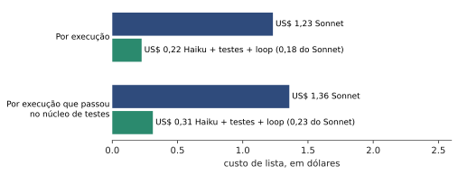
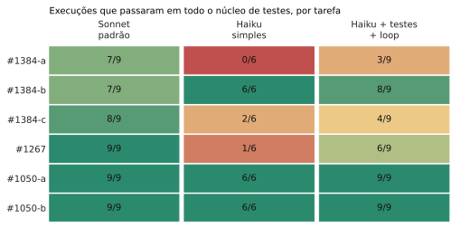
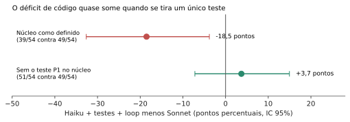
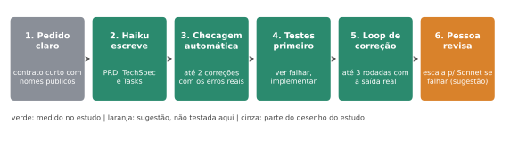

**The plain version of the study "SDD with Haiku only".** If you want the scientific rigor, read the technical article. This is what it means for someone who wants to use Haiku tomorrow.

## In one sentence

Haiku does the job of **writing documents** (PRD, technical spec, tasks) almost as well as Sonnet for **about 1/5 of the price**. On **code**, it works well when you put it in a process with tests and correction; alone, it fails more. The study does not prove it is worse or equal on code.

## What we tested

We ran the full cycle (PRD, technical spec, tasks and code) **198 times** on a real open-source project, h3, with Haiku 5.5 and Sonnet 5.5, and checked the code with hidden tests the model never saw. Three AI judges, without knowing which model wrote each document, scored the documents.

## What we found

**1. Cost.** Haiku with the process below cost **US$ 0.22 per run, against US$ 1.23 for Sonnet**. Counting only the runs where the code passed the tests, it is US$ 0.31 against US$ 1.36.

**2. Documents.** On TechSpec and Tasks scores, Haiku was practically tied with Sonnet: less than 1 point apart, out of 35 and 25. Note: the judges did not see the original request, so this measures text quality and structure, not "faithful to the request".

**3. Code.** Here is the map by task (green always passed, red almost never):

- **Plain Haiku** (no process) did badly on three tasks.
- **Haiku with tests first and a correction loop** improved a lot, but still failed on #1384-a, #1384-c and #1267.
- Almost all of Haiku's failures on the #1384 tasks came from **one edge case** (asking for a route that does not exist and getting the error in the right format). Without that case, Haiku passes as much as Sonnet.

## The recipe that worked best

1. **A clear, short request.** Say what the feature does, with the **exact names** (functions, options, response formats) and expected behaviors. The vaguer the request, the more the model invents.
2. **Haiku writes the documents.** PRD, technical spec and tasks. This is where it pays off most for the price.
3. **Automatic document checks.** A simple script checks what a human does not need to: whether headings follow the agreed format, whether the files and lines cited exist, whether every PRD requirement is covered by a task. If it fails, give Haiku the **real errors**, at most twice. In practice the gate rarely failed (3 of 234 documents), so it is a cheap safety net.
4. **Tests first.** Ask Haiku to write tests from the spec, run them and **watch them fail**, and only then implement.
5. **Correction loop with real output.** Run tests, `typecheck` and lint, and give the model what the command actually printed, for up to 3 rounds.
6. **A person reviews.** And if the code still does not pass the tests, **hand the task to a larger model** (Sonnet). Note: this last step is a suggestion. The study did not test real escalation (the study's cascade never escalated).

Steps 1 to 5 are what was measured. Step 6 is the natural conclusion, but it is still a hypothesis.

## What is not worth it

- **Asking Haiku to "improve" its own text with no check.** It was a control in the study; there is no evidence it helps.
- **Putting Sonnet only on the technical spec** (hybrid): it cost more than 3 times the cascade without improving scores.
- **Counting on persona and extra context in the prompt** as a magic fix: the gain, if any, is about 1 point and is still a weak signal.

## To start tomorrow

- [ ] Pick a small feature that already has automated tests.
- [ ] Write the request with exact names and expected behaviors.
- [ ] Ask Haiku for the three documents and run a simple check on them.
- [ ] Ask for tests first, then the code, and feed back the real command output.
- [ ] Review. If it fails more than 3 rounds, hand it to a larger model.
- [ ] Record cost and result. Your project may give different numbers than ours.

## What we do not know yet

We tested **one project** (TypeScript, three features). The conclusion on code is still open, and the document rubric has limitations. But the path (Haiku on documents, tests first and correction on code, a person reviewing) is cheap and showed results in several cases. The technical article has the numbers, the intervals and everything that may be wrong.

---
*The experiments, data and conclusions are mine. The writing was AI-assisted and reviewed by me.*
