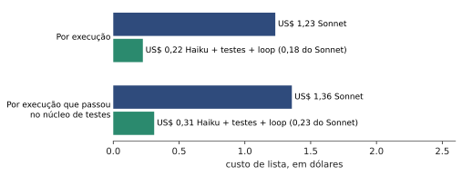
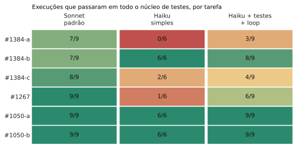
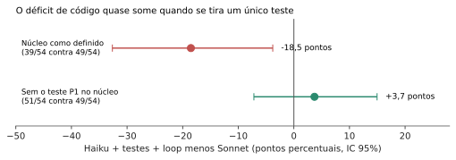
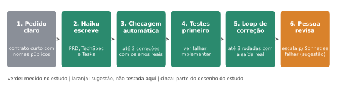

**Versão simples do estudo "SDD só com Haiku".** Se você quer o rigor científico, leia o artigo técnico. Aqui está o que ele significa para quem quer usar o Haiku amanhã.

## Em uma frase

O Haiku faz o trabalho de **escrever documentos** (PRD, especificação técnica, tarefas) quase tão bem quanto o Sonnet por **cerca de 1/5 do preço**. No **código**, ele funciona bem quando você o coloca num processo com testes e correção; sozinho, erra mais. O estudo não prova que ele é pior ou igual em código.

## O que a gente testou

Rodamos **198 vezes** o ciclo completo (PRD, especificação técnica, tarefas e código) num projeto aberto de verdade, o h3, com o Haiku 5.5 e o Sonnet 5.5, e conferimos o código com testes escondidos que o modelo nunca viu. Três juízes de IA, sem saber qual modelo escreveu cada documento, deram notas aos documentos.

## O que a gente descobriu

**1. Custo.** O Haiku com o processo abaixo custou **US$ 0,22 por execução, contra US$ 1,23 do Sonnet**. Se contarmos só as execuções em que o código passou nos testes, são US$ 0,31 contra US$ 1,36.

**2. Documentos.** Nas notas de TechSpec e Tasks, o Haiku ficou praticamente empatado com o Sonnet: diferença de menos de 1 ponto, de 35 e de 25 possíveis. Atenção: os juízes não viam o pedido original, então isso mede qualidade do texto e da estrutura, não "ficou fiel ao pedido".

**3. Código.** Veja o mapa por tarefa (verde passou sempre, vermelho quase nunca):

- O **Haiku simples** (sem processo) foi mal em três tarefas.
- O **Haiku com testes primeiro e loop de correção** melhorou bastante, mas ainda falhou em #1384-a, #1384-c e #1267.
- Quase toda a falha do Haiku nas tarefas #1384 foi **um único caso de borda** (pedir uma rota que não existe e receber o erro no formato certo). Sem esse caso, o Haiku passa tanto quanto o Sonnet.

## A receita que funcionou melhor

1. **Pedido claro e curto.** Diga o que a feature faz, com os **nomes exatos** (funções, opções, formatos de resposta) e os comportamentos esperados. Quanto mais vago o pedido, mais o modelo inventa.
2. **O Haiku escreve os documentos.** PRD, especificação técnica e tarefas. É aqui que ele rende mais pelo preço.
3. **Checagem automática dos documentos.** Um script simples confere o que dá para conferir sem ser humano: se os cabeçalhos estão no formato combinado, se os arquivos e linhas citados existem, se toda exigência do PRD foi coberta por uma tarefa. Se reprovar, devolva ao Haiku **os erros reais**, no máximo duas vezes. Na prática o gate raramente reprovou (3 em 234 documentos), então ele é um seguro barato.
4. **Testes primeiro.** Peça ao Haiku que escreva testes a partir da especificação, rode e **veja falhar**, e só então implemente.
5. **Loop de correção com a saída real.** Rodar testes, `typecheck` e lint, e devolver ao modelo o que o comando realmente imprimiu, em até 3 rodadas.
6. **Uma pessoa revisa.** E se o código ainda não passar nos testes, **passe a tarefa para um modelo maior** (Sonnet). Atenção: esse último passo é uma sugestão. O estudo não testou escalar de verdade (a cascata do estudo nunca escalou).

Os passos 1 a 5 são o que foi medido. O passo 6 é a conclusão natural, mas ainda é hipótese.

## O que não vale a pena

- **Pedir ao Haiku para "melhorar" o próprio texto sem nenhuma checagem.** Foi um controle do estudo; não há evidência de que ajude.
- **Pôr o Sonnet só na especificação técnica** (modelo híbrido): custou mais de 3 vezes o da cascata sem melhorar as notas.
- **Contar com persona e contexto extra no prompt** como solução mágica: o ganho, se existe, é de cerca de 1 ponto e ainda é um sinal fraco.

## Para começar amanhã

- [ ] Escolha uma feature pequena e com testes automáticos já existentes.
- [ ] Escreva o pedido com nomes exatos e comportamentos esperados.
- [ ] Peça ao Haiku os três documentos e rode uma checagem simples neles.
- [ ] Peça os testes primeiro, depois o código, e devolva a saída real dos comandos.
- [ ] Revise. Se falhar mais de 3 rodadas, passe para um modelo maior.
- [ ] Anote o custo e o resultado. Seu projeto pode dar números diferentes dos nossos.

## O que ainda não sabemos

Testamos **um projeto** (TypeScript, três funcionalidades). A conclusão sobre o código ainda é aberta, e a rubrica dos documentos tem limitações. Mas o caminho (Haiku nos documentos, testes primeiro e correção no código, pessoa revisando) é barato e mostrou resultado em vários casos. O artigo técnico traz os números, os intervalos e tudo que pode estar errado.

---
*Os experimentos, os dados e as conclusões são meus. A redação foi assistida por IA e revisada por mim.*
