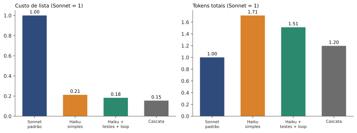
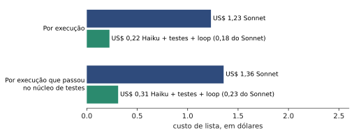
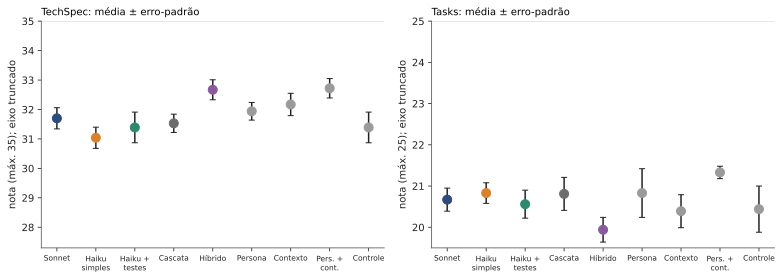
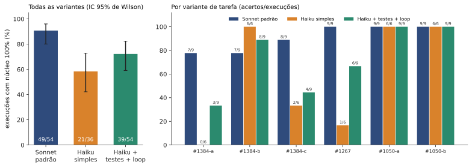
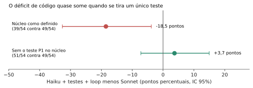
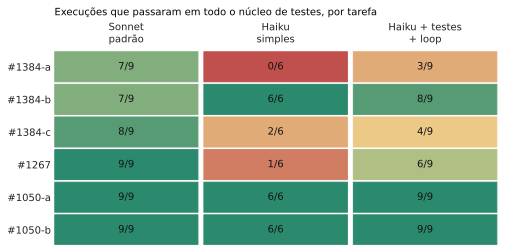

**TL;DR.** I measured Claude Haiku 5.5 against Sonnet 5.5 on spec-driven development (SDD: PRD, technical spec, tasks and code) in the open-source project h3, over 198 isolated runs. For about **1/5 of the list cost** (0.18 of Sonnet), Haiku writes **TechSpec and Tasks documents with almost the same scores** as Sonnet, but it **gets the full code right in 72% of runs against 91%** for Sonnet. Most of that gap is **a single test** (a non-existent route answering 404 as problem+json, which the task contract did not explicitly ask for); without it Haiku is at 94% against 91%. And when tasks, not runs, are the unit, the interval includes zero. So the study **does not decide** whether Haiku loses on code. What the measurement supports: cost drops to about 1/5, documents do not differ by 3 points or more, the hybrid design does not pay for its cost, and Haiku with tests first and a loop improves a lot over simple Haiku. By the rule I wrote beforehand, the formal verdicts for H1, H4, H5 and H11 come out "underpowered", because the rubric fell below the reliability I required and there are few tasks per condition. An independent adversarial review recomputed the numbers, found them right and several readings overstated; they are corrected here.

## The question

Each SDD stage is a request to a model: write the PRD, the TechSpec, the task list and finally the code. Small models cost a fraction of large ones. The practical question is: **can the whole cycle be delivered with the small model and the right engineering around it (tests first, gates, a correction loop) without losing much quality?** Most of what you read about this is opinion. I wanted numbers, with the rules written down beforehand. The closest design I found in the literature, by Rosa et al. (2026), is a study registration with no results yet.

## Hypotheses (summary)

I wrote 11 hypotheses before running anything, with margins and decision rules (git tag `prereg-haiku-sdd-producao`, plus three dated addenda). The main ones:

- **H1:** simple Haiku falls at least 3 points below Sonnet on documents.
- **H4:** with tests first and a correction loop, Haiku's code passes the hidden tests within 10 percentage points of Sonnet.
- **H5:** a cascade (Haiku, escalating to Sonnet if the gate rejects) keeps 90% of the quality for at most 50% of the cost.
- **H6:** describe the cost and tokens of Haiku with mitigations against Sonnet.
- **H11:** persona and detailed context improve Haiku's documents.

Four of them (H2, H7, H8, H9) are **out of this study** by my decision: voting, planted errors, caching and extra variations are left for a future paper.

## How I measured

- **Target project:** h3 (TypeScript), three features (#1267, #1384, #1050), six task variants, at a fixed commit.
- **Conditions:** C0 default Sonnet; C1 simple Haiku; C4 Haiku with tests first and a correction loop fed by the runner's output (the idea comes from Mathews and Nagappan, 2024); C5 cascade (in the spirit of FrugalGPT by Chen, Zaharia and Zou, 2023); C6 hybrid (TechSpec by Sonnet); C2 and C2n (gate with loop and self-review without feedback, as a control, since Huang et al., 2023, show that models correct their own reasoning poorly without an external signal); C10 to C13 (persona, context, both, and a length control).
- **Isolated runs:** each stage is a fresh CLI process in a folder with an opaque name, without the project's git history or remote, with the web denied and tools restricted. The order of the 198 runs was drawn at random (fixed seed), one at a time.
- **Code:** hidden tests that I wrote and encrypted, plus `typecheck` and `lint`. A run counts as good only with 100% of the expected core tests.
- **Documents:** TechSpec (35 points) and Tasks (25) scored by three isolated Opus judges, blind, with random codes (model as judge, with the biases described by Zheng et al., 2023). h3's `CLAUDE.md` and `AGENTS.md` were present in every condition, because Gloaguen et al. (2026) show that repository context files can change the outcome.
- **Cost:** actual token consumption and list cost as measured by the tool itself (prices of 2026-11-04: Haiku 5.5 at US$ 0.10 and US$ 0.50 per million tokens up to 100 thousand prompt tokens, Sonnet 5.5 at US$ 2 and US$ 10).
- **Two rounds, both registered before the data:** 138 planned runs and an extension of 60 (a one-round stopping rule), with the primary and the extended analyses side by side.

All code, raw data, prompts and transcripts are in the study repository, and one command reproduces the tables in a clean clone.

## Results

### Cost: Haiku wins by a wide margin, even using more tokens

Haiku with tests first and a loop (C4) costs **0.18 of Sonnet** in list dollars (95% CI: 0.16 to 0.20). In return it uses **1.5 times** Sonnet's total tokens (1.39 to 1.64) and 1.55 times the new tokens. The cascade comes in at 0.15. In 52 of the 54 C4 runs the prompt went past 100 thousand tokens, where Haiku's price goes up; the tool already charges that tier, so the 0.18 ratio includes it. By the metric I had registered, cost per run with an accepted core, it is US$ 0.31 for C4 against US$ 1.36 for Sonnet (ratio 0.23); by variant, C4's cost ranges from 0.14 to 0.23 of Sonnet's. The 100 thousand figure is only a price step, not a context limit, and failures are not associated with prompt size.

| Condition | Runs | Mean list cost | Mean total tokens |
|---|---|---|---|
| Default Sonnet (C0) | 54 | US$ 1.23 | 2.41 M |
| Simple Haiku (C1) | 36 | US$ 0.26 | 4.13 M |
| Haiku + tests + loop (C4) | 54 | US$ 0.22 | 3.64 M |
| Cascade (C5) | 12 | US$ 0.19 | 2.88 M |

### Documents: nearly a tie, but with a fragile instrument

With 18 artifacts per arm and all three features, Sonnet is **0.7 points above** simple Haiku on TechSpec (95% CI: −0.2 to +1.6, out of 35) and **0.2 below** on Tasks (−0.8 to +0.5, out of 25). Far from the 3 points H1 predicted. The cascade scores 0.99 and 1.01 of Sonnet's, at 0.15 of the cost. **The weak point:** Krippendorff's alpha between the judges was **0.61**, below the 0.67 I had set, and the scores are stuck near the ceiling (about 32 out of 35). By my own rule, the document hypotheses come out formally **underpowered**: the rule only allows "confirmed" with a reliable rubric. Two reading cautions: that alpha was computed per rubric criterion; for the mean of the three judges (the score that decides), estimated reliability goes above 0.67 (about 0.72 on TechSpec and 0.83 on Tasks, by Spearman-Brown, exploratory). And the intervals already exclude a difference of 3 points or more; what remains uncertain is whether the rubric, saturated near the ceiling and without access to the original request, sees real quality differences. The judges do not see the PRD, so "coverage of the request" was not measured. So "nearly a tie" holds for what the rubric measures.

### Code: where Haiku still loses

Sonnet passed the core in 49 of 54 runs (91%). Haiku with tests first and a loop (C4) passed in 39 of 54 (72%), and simple Haiku in 21 of 36 (58%). The difference between C4 and Sonnet is **−18.5 points**, with a one-sided Newcombe interval of −32.6 to −3.8: the interval **does not rule out a deficit smaller than the 10-point margin**, so H4's formal status is "underpowered". But two warnings change the reading, both from the adversarial review:

1. **The deficit is almost one test.** Of the 15 C4 runs that failed the core, 12 failed only on P1 ("non-existent route answers 404 as problem+json"), in the #1384 tasks. The lean contract for #1384-a and #1384-c does not explicitly ask for it, and I classified P1 as core after the pilot. If P1 were an observation, C4 would pass 51 of 54 (94%) against Sonnet's 49 of 54 (91%), a difference of +3.7 points (95% CI −7.2 to +15.0). The sign flips. So **do not read "72% against 91%" as general code quality**: what the data show is that Haiku handles this edge case worse, plus the failures on #1267 (3 runs).
2. **The unit is the task, not the run.** The Newcombe interval treats the 54 runs as independent, but generalization is to tasks. By variant the difference was −44, +11, −44, −33, 0 and 0 points; the 95% t interval over 6 variants is −45 to +8 (by feature, −63 to +24), and includes zero. Two of the six variants (#1050) saturate at 100% in every condition. "Negative with credibility" holds only for these six tasks.

Saying "Haiku matches Sonnet on code" would be false; saying "it loses by more than 10 points" would be too.

The pattern is by task, not general:

| Variant | Sonnet | Simple Haiku | Haiku + tests + loop |
|---|---|---|---|
| #1384-a | 7/9 | 0/6 | 3/9 |
| #1384-b | 7/9 | 6/6 | 8/9 |
| #1384-c | 8/9 | 2/6 | 4/9 |
| #1267 | 9/9 | 1/6 | 6/9 |
| #1050-a | 9/9 | 6/6 | 9/9 |
| #1050-b | 9/9 | 6/6 | 9/9 |

In both #1050 variants everyone reaches 100%. The loss shows up in #1384-a, #1384-c and #1267. If we count the fraction of tests passing (including the observation tests), the picture is milder: 0.89 for C4 against 0.91 for Sonnet. From 58% (simple Haiku) to 72% (C4) there is an improvement, but it **cannot be attributed to "tests first and a loop"**: C4 against C1 is +13.9 points with a 95% CI of −8.3 to +35.4, inconclusive. Also, in many runs some test commands were denied by the allowed-tools list (count from the adversarial review: 146 denials for Sonnet and 74 for C4), which may have limited the "loop with real output".

### What did not work or could not be tested

- **Hybrid (H10):** putting Sonnet on the TechSpec and Haiku on the rest costs **3.1 times** the cascade (2.5 to 4.0) with no score gain. Refuted by the cost criterion, which does not depend on the rubric.
- **Cascade:** the gate rejected only 3 of 234 documents (1.3%), and the cascade **never escalated** to Sonnet in the 12 runs. It is equivalent to Haiku with gates, and escalation was not tested (H3 and that part of H5 are "not testable in this design"). Worse: by construction the cascade only escalated code if `typecheck` failed, and in all 198 runs `typecheck` and `lint` never failed; the deficit is in the hidden tests, which the trigger cannot see. So "never escalated" is true but tautological: a real cascade was **not tested**.
- **Persona and context (H11):** persona plus context together (C12) gave something like +1 point (+0.9 on TechSpec and +1.1 on Tasks) when compared within variant, with the length control near noise. Only two variants have both conditions paired (3 artifacts per cell); p is around 0.03 to 0.06, with no correction for multiple comparisons. A signal to investigate, not a proven effect.
- **Citation hallucinations (exploratory):** on paired documents (TechSpec of #1267 and #1050-b, repetitions 1 to 3, same document prompt in C0, C1 and C4), the mean of invented citations per judgment was 0.00 for Sonnet, 0.22 for C1, 0.67 for C4 and 0.39 for the cascade (18 judgments each). Since Haiku's prompts are identical across C1, C4 and C5, the difference among them is probably sampling noise. Worth its own measurement.

## What this means in practice

- For **writing TechSpec and Tasks**, Haiku seems to be very close to Sonnet at about 1/5 of the dollars. I would use it, checking the result, and not treat this as a guarantee.
- For **implementing code**, Haiku with tests first and a loop got some tasks right less often (but the general deficit is not demonstrated). I would have Haiku write the documents and leave the harder code to Sonnet, or escalate to Sonnet when the tests fail. That design was **not tested here**.
- Haiku's token cost is higher; it is the price per token that makes it cheap. Above 100 thousand tokens of context, the math changes.

## Limitations

One project (h3, TypeScript), three features and six variants; models and prices as of 2026-11-04; judges that are samples of the same model (alpha 0.61 per criterion) and do not see the PRD; tests written by me, with the core defined by me after the pilot; an extension triggered by the partial result and a reduction of judges decided after seeing the primary (both registered before seeing the extension data; the final interval does not correct for this interim look, and the extension repeats the primary's pattern); the study's git history still holds old versions of the tests in clear text, out of the agent's reach; the duration of the extension runs may have been affected by a judge running in parallel (tokens and cost are not affected); phase C (voting, planted errors, caching) was left out. The full threats to validity are in the repository.

## Conclusion

Haiku 5.5 cuts the cost to about 1/5 and delivers SDD documents very close to Sonnet's, but it **loses more on the code of some tasks** (mainly one #1384 edge case and #1267), and the study cannot say whether the overall loss is small, large or null. "The whole SDD with Haiku only, without losing quality" is **not what the data show**. What they show is a good case for a hybrid design (documents on Haiku, hard code on Sonnet), which is left for the next study.

## References

- Anthropic. *Pricing* (API documentation), accessed 2026-11-04. https://platform.claude.com/docs/en/about-claude/pricing
- Chen, Zaharia, Zou. *FrugalGPT: How to Use Large Language Models While Reducing Cost and Improving Performance.* arXiv:2305.05176, 2023.
- Mathews, Nagappan. *Test-Driven Development for Code Generation.* arXiv:2402.13521, 2024.
- Huang et al. *Large Language Models Cannot Self-Correct Reasoning Yet.* arXiv:2310.01798, 2023.
- Zheng et al. *Judging LLM-as-a-Judge with MT-Bench and Chatbot Arena.* arXiv:2306.05685, 2023.
- Gloaguen et al. *Evaluating AGENTS.md: Are Repository-Level Context Files Helpful for Coding Agents?* arXiv:2602.11988, 2026.
- Rosa et al. *Understanding Specification-Driven Code Generation with LLMs: An Empirical Study Design.* arXiv:2601.03878, 2026 (study design, no results).
- Study data, code and prompts: repository `melolabs-dev/melolabs`, folder `studies/haiku-sdd-producao`, tags `prereg-haiku-sdd-producao`, `-adendo1`, `-adendo2` and `-adendo2b`.

---
*The experiments, data and conclusions are mine. The writing was AI-assisted and reviewed by me.*
