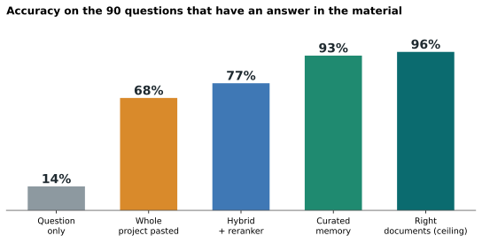
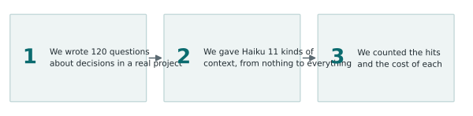
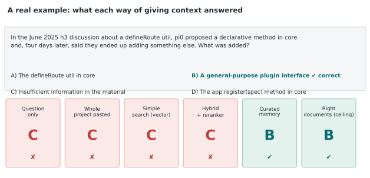
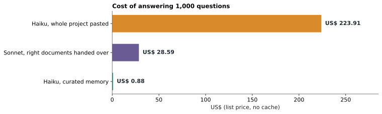
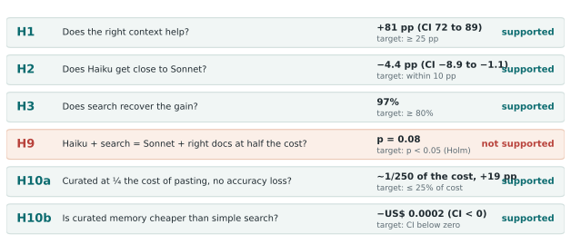
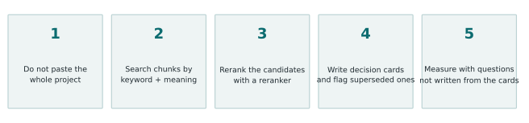

**Plain-language version of the "Haiku with a mini data lake" study.** For the full method and numbers, read the [technical article](/en/rag-data-lake-haiku/). This is what it means if you want to use it tomorrow.

## In one sentence

A Haiku with no project material gets **14%** of the decisions that depend on project history right. With a **curated project memory** it gets **93%**, and each answer costs **about 250 times less** than pasting the whole project into the prompt.

## What we did

We built a "mini data lake" from a real open-source project (h3): 109 documents and 152 **decision cards**, which are short notes with the decision, the reason, when it applies and whether another decision superseded it. Then we wrote **120 questions** like "what was decided and what holds today?" and had Haiku answer each one **5 times**, in **11 different ways**, for **7,200 answers in total, with no failures**. Before running anything we wrote down the hypotheses and criteria, so we could not move the goalposts after seeing results.

## An example to see it

The question is about a discussion where someone proposed one thing and, days later, ended up doing another. Four ways of giving context, including the whole project pasted in, answered "insufficient information". The curated memory got it right, because the card said which decision superseded which.

## What we found

**1. Without material, Haiku does not "guess well": it abstains.** When it was wrong with no context, it picked "insufficient information" in 73 of 77 answers. The problem is not making things up, it is not knowing an answer exists.

**2. Curated memory gets close to the ceiling.** On the 90 questions that have an answer in the material it got 84 right; handing over the right documents got 86. On the 30 questions where an old and a new decision conflict, it got **30 of 30**.

**3. Pasting everything is costlier and worse.** The whole project is about 224k tokens. Pasting it for every question cost **250 times more** and scored lower (76% vs 95% over the 120).

**4. With the right context, Haiku gets close to Sonnet.** With the right documents Haiku got 86 of 90 and Sonnet 90 of 90, at about 1/19 of the cost.

**5. One simple trick is worth a lot: reorder the search results.** Asking a reader model (a "reranker") to reorder the 30 best candidates raised accuracy from 88 to 99 out of 120.

**6. Irrelevant text does not hurt when the right material is there too.** Mixing random chunks or superseded decisions into the right material changed almost nothing (86 and 87 of 90). On its own, noise is worse than giving nothing.

## What the hypotheses meant

Before running, we fixed six questions and how much result would count as "yes". Five passed:

- **H1:** does the right context really help? Yes, +81 points.
- **H2:** is Haiku close to Sonnet with the right context? Yes, within 4 points.
- **H3:** does automatic search recover the gain of the right context? Yes, 97% of it.
- **H9:** does Haiku with search match Sonnet with the right documents at half the cost? Cost passed easily, but the accuracy evidence did not meet our criterion. It stays **not confirmed**.
- **H10a and H10b:** is curated memory far cheaper than pasting everything and than simple search? Yes, on both.

## What did not work, and what to keep in mind

- **The "abstention gate"** (answering "not enough information" without calling the model when search finds little) made results worse. It abstains too much. Do not use it as is.
- **The questions came from the same cards the curated memory delivers.** In 79 of the 90 questions, the source card was among those delivered. In a real project your questions do not come from your cards. The jump from 83% to 95% over the best search is a **ceiling**, not a forecast. The advantage of reranked search over pasting everything does not have this problem.
- **One project, 120 multiple-choice questions**, an answer key written by AI from the same family as the models tested.

## The recipe

1. **Do not paste the whole project.** More context is not more accuracy.
2. **Search chunks**, combining keywords and meaning.
3. **Rerank** the candidates with a reranker.
4. **Write decision cards** (decision, reason, when it applies, what it supersedes) and **flag what was superseded**.
5. **Measure with questions you did not write from your own cards.**

All code, questions and raw data are in the [study repository](/en/rag-data-lake-haiku/), so you can check or repeat it.
