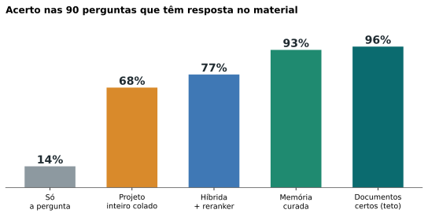
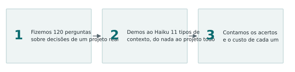
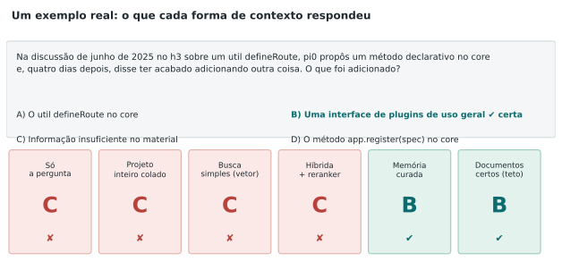
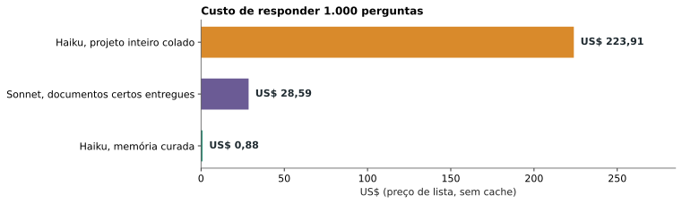
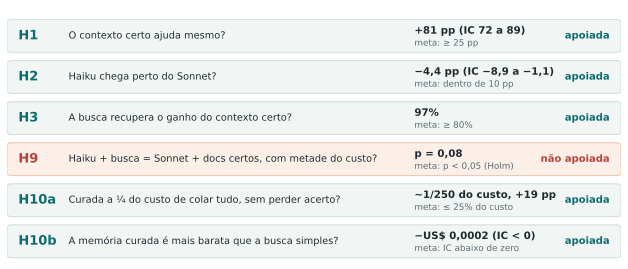
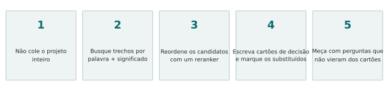

**Versão simples do estudo "Haiku com mini data lake".** Para o método completo e os números, leia o [artigo técnico](/pt/rag-data-lake-haiku/). Aqui está o que ele significa para quem quer usar isso amanhã.

## Em uma frase

Um Haiku sem nenhum material do projeto acerta **14%** das decisões que dependem do histórico. Com uma **memória curada do projeto**, ele acerta **93%**, e cada resposta custa **cerca de 250 vezes menos** do que colar o projeto inteiro no prompt.

## O que a gente fez

Montamos um "mini data lake" de um projeto aberto de verdade (o h3): 109 documentos e 152 **cartões de decisão**, que são fichas curtas com a decisão, o motivo, quando vale e se foi substituída por outra. Depois escrevemos **120 perguntas** do tipo "o que foi decidido e o que vale hoje?" e deixamos o Haiku respondê-las **5 vezes cada**, de **11 jeitos diferentes**, num total de **7.200 respostas, sem nenhuma falha**. Antes de rodar, escrevemos as hipóteses e os critérios, para não ajustar a régua depois de ver o resultado.

## Um exemplo para entender

A pergunta é sobre uma discussão em que alguém propôs uma coisa e, dias depois, acabou fazendo outra. Quatro jeitos de dar contexto, inclusive o projeto inteiro colado, responderam "informação insuficiente". A memória curada acertou, porque o cartão dizia qual decisão substituiu qual.

## O que a gente descobriu

**1. Sem material, o Haiku não "chuta bem": ele se abstém.** Quando errou sem contexto, ele escolheu "informação insuficiente" em 73 de 77 respostas. O problema não é inventar, é não saber que existe resposta.

**2. A memória curada chega perto do teto.** Nas 90 perguntas que têm resposta no material, ela acertou 84; entregar os documentos certos de bandeja acertou 86. Nas 30 perguntas de conflito entre decisão antiga e nova, acertou **30 de 30**.

**3. Colar tudo é mais caro e pior.** O projeto inteiro tem cerca de 224 mil tokens. Colar isso em cada pergunta custou **250 vezes mais** e acertou menos (76% contra 95% no conjunto de 120).

**4. Com o contexto certo, o Haiku chega perto do Sonnet.** Com os documentos certos, o Haiku acertou 86 de 90 e o Sonnet 90 de 90, a cerca de 1/19 do custo.

**5. Um truque simples vale muito: reordenar os resultados da busca.** Pedir a um modelo leitor (um "reranker") para reordenar os 30 melhores candidatos subiu o acerto de 88 para 99 em 120.

**6. Texto irrelevante não derruba quando o material certo está junto.** Misturar trechos aleatórios ou decisões já substituídas ao material certo mudou quase nada (86 e 87 de 90). Sozinho, o ruído é pior do que dar nada.

## O que as hipóteses queriam dizer

Antes de rodar, fixamos seis perguntas e quanto de resultado bastaria para dizer "sim". Cinco delas passaram:

- **H1:** dar o contexto certo ajuda de verdade? Sim, +81 pontos.
- **H2:** o Haiku fica perto do Sonnet com o contexto certo? Sim, a 4 pontos.
- **H3:** uma busca automática recupera o ganho do contexto certo? Sim, 97% dele.
- **H9:** Haiku com busca iguala o Sonnet com documentos certos, por metade do custo? O custo passou com folga, mas a evidência do acerto não passou do nosso critério. Fica como **não confirmada**.
- **H10a e H10b:** a memória curada é bem mais barata que colar tudo e que a busca simples? Sim, nas duas.

## O que não funcionou, e o que fica de cuidado

- **O "portão de abstenção"** (responder "não sei" sem chamar o modelo quando a busca acha pouco) piorou o resultado. Ele abstém demais. Não use como está.
- **As perguntas saíram dos mesmos cartões que a memória curada entrega.** Em 79 das 90 perguntas, o cartão de origem estava entre os entregues. Num projeto real, suas perguntas não saem dos seus cartões. O salto de 83% para 95% sobre a melhor busca é um **teto**, não uma previsão. A vantagem da busca com reranker sobre colar tudo não tem esse problema.
- **Um projeto, 120 perguntas de múltipla escolha**, gabarito escrito por IA da mesma família dos modelos testados.

## A receita

1. **Não cole o projeto inteiro.** Mais contexto não é mais acerto.
2. **Busque trechos** combinando palavra-chave e significado.
3. **Reordene** os candidatos com um reranker.
4. **Escreva cartões de decisão** (decisão, motivo, quando vale, o que substitui) e **marque o que foi substituído**.
5. **Meça com perguntas que você não escreveu a partir dos seus cartões.**

Todo o código, as perguntas e os dados brutos estão no [repositório do estudo](/pt/rag-data-lake-haiku/), para você conferir ou repetir.

Dados e código do estudo, arquivados com DOI: [10.5281/zenodo.24101665](https://doi.org/10.5281/zenodo.24101665).

---
*Os experimentos, os dados e as conclusões são meus. A redação foi assistida por IA e revisada por mim.*
