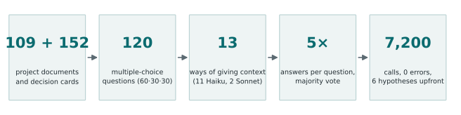
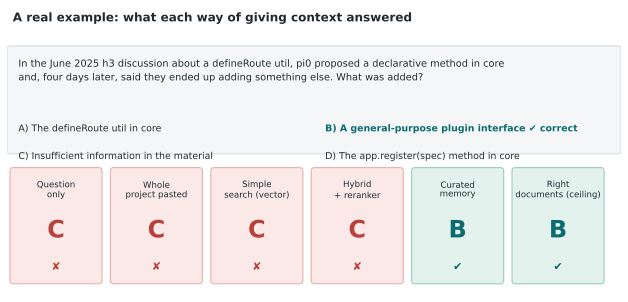
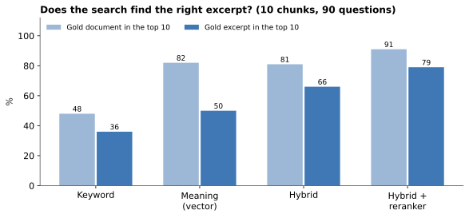
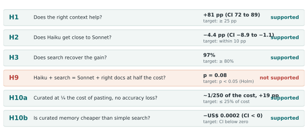
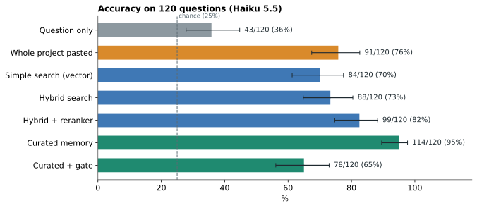
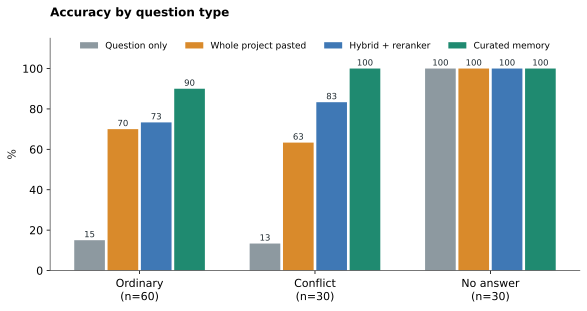
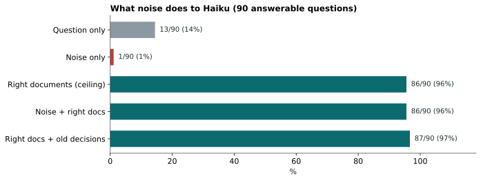
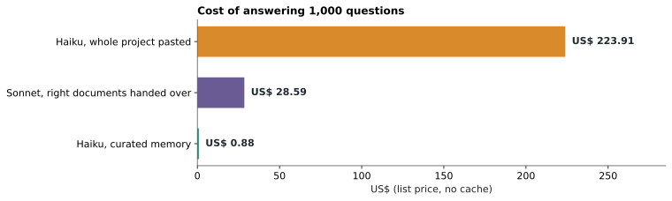

**Abstract.** We preregistered six hypotheses and ran 7,200 calls, with no failures, to measure whether a small model (Haiku 5.5), given a mini data lake from an open-source project, decides like a larger model given the right context. The strongest result: a curated project memory (retrieved chunks, decision cards and a flag for what was superseded) took Haiku to **114 correct out of 120 questions**, against 43 with no context, 91 with the whole project pasted into the prompt and 99 with the best search without curation, at **about 1/250 of the cost of pasting everything**. Five of the six hypotheses were supported after Holm correction; one (H9) was not. The main threat to validity is circular and is declared in section 9: the questions were derived from the same cards the curated memory delivers. For the practical summary, see the [plain-language guide](/en/rag-data-lake-haiku-guia/).

## 1. The question and the decision it informs

In [study 1](/en/haiku-sdd-producao/), Haiku came close to Sonnet on documents, and on code with process, at a fraction of the price. Hypothesis H2 stayed open: does Haiku also decide well when the decision depends on project history (why A was chosen over B, what was superseded, what holds today)? That is the daily reality of anyone running agents on a long project, and the answer guides where to invest: a bigger model, a longer context, or retrieval and curation of the material.

**Study question:** does Haiku with a mini data lake of the project decide as well as a larger model with the right context, and at what cost per correct decision?

## 2. The material

### 2.1 The lake

The lake is the set of material the model may consult. We used the open-source project h3 (commit `f0e17808`), with 109 documents from four sources: code, issues and pull requests, documentation, and study 1 itself (protocol, addenda, decisions). Each document was split into chunks of up to 600 characters with 100 overlap, giving 1,292 indexed chunks.

On top of the documents we built **152 decision cards**. A card is a short note with the decision, the reason, when it applies, what it supersedes and the sources (document and excerpt). Of the 152 cards, 107 are current, 38 were superseded by another decision and 7 are context. A real example, from an h3 discussion:

| | Old card (superseded) | New card (current) |
|---|---|---|
| Decision | pi0 proposed that core gain a declarative `app.register(spec)` method instead of an opinionated `defineRoute` | pi0 ended up adding a more generic plugin interface (#1098) in place of the earlier `app.register` proposal |
| Reason | worry about putting too much opinion in a `defineRoute`, making it less flexible | not stated |
| Relation | superseded by the new card | supersedes the old card |

This structure is what lets you ask "what holds today?" and not only "what was said?". The cards were checked against the source documents by a script (`verificar_cartoes.py`).

### 2.2 The 120 questions

120 multiple-choice questions with four options, one of which is always "Insufficient information in the material". Three blocks:

- **60 ordinary:** the answer is in one or a few documents (for example, "from which release candidate of h3 2.0.1 did `serveStatic` stop resolving a pathname like `//private/x`, and what does it return by default?").
- **30 conflict:** there is an old and a current decision. One wrong option deliberately describes the old decision, to measure whether the model falls for what was superseded.
- **30 no answer:** the question looks reasonable but the material does not contain the answer; the right option is "Insufficient information". They measure whether the model makes things up.

Option letters were shuffled with a fixed seed (20261109) so the right answer does not always sit in the same position. A real example from the conflict block, with the answer of each way of giving context, shows what the run measures:

In this example, four ways of giving context answered C ("insufficient information"), and only the curated memory and the right documents handed over reached B. It is a pattern that repeats and is discussed in section 7.

### 2.3 The answer key and how we validated it

The answer key (right answer, option reflecting the superseded decision, sources and cards for each question) was written by AI, so we validated it three ways before the run:

1. **Blind review:** a review without access to the key agreed on 118 of 120 on the first pass and on 120 of 120 after fixes. This measures consistency, not independent accuracy.
2. **Validation with the gold documents:** Haiku answered each question 5 times given only the gold documents; it got 86 of the 90 answerable questions right by vote. We checked the four misses against the sources and the key held in all four (one of them, q119, is Haiku's prior knowledge conflicting with the material). No question was changed.
3. **Separate calibration:** 20 extra questions (6 ordinary, 4 conflict, 10 no-answer), outside the 120, to fix the abstention-gate threshold of arm A6 without touching the test questions.

The same model family wrote and reviewed the key and runs the arms, which is a declared threat in section 9.

## 3. The arms: what each one receives and why it exists

Each "arm" is a different way of giving Haiku context. All answer the same 120 questions, 5 times each, and each question's result is the majority vote of the 5 answers (ties go to the lowest letter).

| Arm | What Haiku receives | The question it answers |
|---|---|---|
| **A0** | only the question | how much does it already know without the material? (baseline) |
| **A1** | the whole gold documents (answerable 90 only) | what is the ceiling if search were perfect? |
| **A2** | the whole lake (~224k tokens) in the system prompt, cached | does pasting everything solve it? at what cost? |
| **A3** | the 10 chunks closest by meaning (vector) | is the simplest search enough? |
| **A4a** | 10 chunks from a hybrid: keyword (BM25) + vector, fused by rank (RRF) | does combining both signals help? |
| **A4b** | the top 30 of the hybrid, reordered by a reranker model (bge-reranker-v2-m3) | does reordering with a reading model help? |
| **A5** | the 10 chunks of A4b plus 3 cards; when a card is superseded the decision that supersedes it comes along; each chunk is tagged with its decision status | does curation add to search? |
| **A6** | A5 with a gate: if the top reranker score is below 1.05, the system answers "insufficient" without calling the model | can we save by abstaining when search finds nothing? |
| **S0 / S1** | Sonnet 5.5 with no context / with the gold documents | and a larger model, in the same situation? |
| **N1** | 10 chunks drawn from documents outside the gold | what does noise do on its own? (negative control) |
| **N1b** | N1 and then the gold documents | does noise hurt when the gold is present? |
| **N2** | gold and then 3 chunks of already superseded decisions | do old decisions in the context mislead the model? |

Controls N1, N1b and N2 exist so that "the context helped" is not confused with "any text in the prompt helps". If irrelevant text made Haiku score well, the gain of the other arms would prove nothing.

## 4. The design choices, and how we set them before the run

Before the main run we ran a **15-question pilot** (5 per block) to fix the parameters. Every value below was set in it and frozen in the preregistration (`prereg-rag-data-lake-haiku`).

- **Search query = only the question text.** We did not use the options or rewrite the question; it is what a real system would have at hand.
- **10 chunks (k = 10).** In the pilot, Haiku with hybrid search got 6 of 10 answerable right with 3, 5, 10 or 15 chunks, with no clear difference, while the recall of the gold document rose (63%, 76%, 81% and 86% for k = 3, 5, 10 and 15). We picked 10 as the balance between finding the document and not filling the prompt.
- **600-character chunks with 100 overlap**, and local embeddings (`paraphrase-multilingual-MiniLM-L12-v2`), because the questions are in Portuguese and much of the lake is in English.
- **5 samples per question with majority vote**, to reduce the noise of a model whose temperature we cannot control (`claude -p` uses the harness default).

### 4.1 Search: why the reranker came in

We measured recall over the 90 questions with an answer key: was the gold among the 10 retrieved chunks?

Keyword-only search was weak (the questions are in Portuguese and the lake is mostly in English, so words rarely match). Vector search finds the document well (82%) but rarely the exact excerpt (50%). The hybrid improves the excerpt (66%), and the reranker, which reads the question and each candidate together, took the gold excerpt to 79% and the document to 91%. That is why A5 uses the reranker as its base, a choice recorded before the run.

### 4.2 Cost: how we measured it

The nominal cost of each call is the number of tokens times the **cold list price**, the same for all arms, so the comparison does not depend on caching. We measured the effective price of `claude -p` in calls with a random prefix (no cache): Haiku US$ 0.20 per million input tokens and US$ 0.50 output (US$ 1.00 input above 125k tokens); Sonnet US$ 4 and US$ 10. Real spend with caching is reported separately.

This matters for A2: pasting 224k tokens on every question would cost US$ 0.22 per call (US$ 134 for the 600 calls). We put the lake in the system prompt, where caching works, and ran the first call alone to warm it: A2's real spend was about US$ 7.40 in total. We also found that caching only works for system-prompt content, not user-message content, which is a declared assembly difference between A2 and the other arms. List-price dollars are not the subscription bill.

## 5. The run

The 7,200 calls ran through `claude -p` with tools off and a short system prompt ("You answer multiple-choice questions about project decisions"), queued: A2 first, then Sonnet, then the other Haiku arms, in about 2 h 10 in total. The runner logs each call with tokens, cost and the extracted letter, resumes where it stopped and refuses calls with zero tokens (the symptom of an expired login, which caught us once in the pilot). Result: **7,200 of 7,200 calls answered, 0 errors, 0 answers without a letter.**

Code, questions, answer key, gate threshold and lake were frozen with hashes before the run (tag `prereg-rag-data-lake-haiku`); the raw data afterwards (tag `dados-rag-data-lake-haiku`).

## 6. The six hypotheses, one by one

Each hypothesis was written before the run with a metric, a threshold and a refutation criterion. The p-values come from a one-sided bootstrap over questions (10,000 replicates): we resample the 120 questions with replacement, recompute the metric and see in how many replicates the criterion fails. Since there are six tests, we apply Holm correction, which makes the limit stricter for each additional hypothesis.

**H1: does the right context really help?** Compares A1 (gold documents) with A0 (question only) on the 90 answerable questions. Criterion: at least 25 percentage points higher; below 15 would refute it. Result: **+81 pp** (95% CI: 72 to 89). It is the expected result, but it confirms the test measures what it should: with no material Haiku gets only 13 of 90.

**H2: is Haiku close to Sonnet?** Compares Haiku with the gold documents to Sonnet with the same documents. Criterion: Haiku within 10 pp. Result: **−4.4 pp** (95% CI: −8.9 to −1.1; Holm p 0.015). Sonnet got all 90; Haiku got 86. This hypothesis closes H2 of study 1.

**H3: does search recover the gain of the right context?** Measures how much of the oracle's gain (A1 over A0) the best retrieval arm (A3, A4a, A4b or A5, chosen inside each bootstrap replicate so as not to favour the winner) recovers. Criterion: at least 80%. Result: **97%**.

**H9: does Haiku with search match Sonnet with the oracle at half the cost?** This is the most demanding hypothesis: the best Haiku RAG has to reach 90% of Sonnet-with-oracle accuracy and cost at most 50% per correct decision. The point estimate was above the criterion (1.04 vs 1.00), but the statistical evidence did not pass the limit after Holm (**p = 0.08**), so **we do not count it as supported**. The cost alone was far below half.

**H10a: does curated memory cost a quarter of pasting the project, with no accuracy loss?** Compares the cost per correct decision of A5 with that of A2, and requires A5's accuracy to be no more than 10 pp lower. Result: **A5 costs about 1/250 per call and 1/320 per correct decision, with 19 pp more accuracy** (114 vs 91). Supported.

**H10b: is curated memory cheaper than simple search?** Compares A5 with A3 per correct decision, in a paired bootstrap; the 95% interval must fall entirely below zero. Result: a difference of **−US$ 0.0002** per correct decision (95% CI: −0.00037 to −0.00009). Supported. The absolute difference is small because both already cost thousandths of a dollar; what matters is that A5 is more accurate while spending almost the same.

A **sensitivity analysis without the 15 pilot questions** (which helped choose k) reaches the same conclusions: A5 99 of 105, H9 with p = 0.14.

## 7. Results

| Arm | Correct/120 | Ordinary | Conflict | No answer | Nominal US$ per correct decision |
|---|---|---|---|---|---|
| A0 Haiku | 43 | 9/60 | 4/30 | 30/30 | 0.00096 |
| A1 Haiku (90) | 86/90 | 57/60 | 29/30 | n/a | 0.00154 |
| A2 whole lake | 91 | 42/60 | 19/30 | 30/30 | 0.295 |
| A3 vector | 84 | 32/60 | 22/30 | 30/30 | 0.00114 |
| A4a hybrid | 88 | 38/60 | 20/30 | 30/30 | 0.00111 |
| A4b + reranker | 99 | 44/60 | 25/30 | 30/30 | 0.00096 |
| **A5 curated** | **114** | 54/60 | 30/30 | 30/30 | **0.00092** |
| A6 gated | 78 | 30/60 | 18/30 | 30/30 | 0.00059 |
| N1 noise | 31 | 0/60 | 1/30 | 30/30 | 0.00292 |
| N1b noise + gold (90) | 86/90 | 57/60 | 29/30 | n/a | 0.00202 |
| N2 gold + superseded (90) | 87/90 | 59/60 | 28/30 | n/a | 0.00168 |
| A0 Sonnet | 62 | 22/60 | 13/30 | 27/30 | 0.0114 |
| A1 Sonnet (90) | 90/90 | 60/60 | 30/30 | n/a | 0.0286 |

### 7.1 What worked

1. **The method worked as a test.** With no material Haiku gets 13 of 90 answerable (14%, below the 25% chance level); with the gold it gets 86; the noise control alone drops it to 1 of 90. The controls behave as they should.
2. **Curated memory came close to the ceiling.** A5 got 84 of the 90 answerable (93%), against 86 (96%) for gold documents handed over, using about 4.1k tokens per call against A2's 224k.
3. **On the conflict block, A5 got 30 of 30**, against 19 for the whole project and 25 for the best search without curation. Flagging what was superseded and delivering the decision that supersedes it solved the problem that raw text did not.
4. **Pasting everything was worse and far costlier.** A2 got 91 (76%) at US$ 0.22 per call; A5 got 114 at US$ 0.0009.
5. **The reranker was the largest single search gain**: from 88 correct (hybrid) to 99, and from 66% to 79% of the gold excerpt retrieved.
6. **Haiku with the right context came close to Sonnet** (86 vs 90), at about 1/19 of the cost (US$ 0.0015 vs US$ 0.0286 per correct decision).
7. **Answers became more stable with curation:** on 111 of the 120 questions all 5 samples of A5 agreed, against 80 for A2 and 104 for A4b.
8. **Cost was measured, not assumed**, and caching cut A2's real spend from US$ 134 at list price to about US$ 7.40.

### 7.2 How Haiku errs

On the 90 answerable questions, we counted what Haiku chose when it was wrong:

| Arm | Correct | "Insufficient information" | Old decision | Other |
|---|---|---|---|---|
| A0 (question only) | 13 | 73 | 1 | 3 |
| A2 (whole project) | 61 | 17 | 5 | 7 |
| A4b (hybrid + reranker) | 69 | 17 | 2 | 2 |
| **A5 (curated)** | **84** | **4** | **0** | **2** |

Haiku's dominant error is not making things up but **abstaining when the answer exists**. In 73 of the 77 wrong answers of A0 and 17 of the 29 of A2, it chose "Insufficient information". Only 5 answers of A2 and 2 of A4b fell for the old decision, and none of A5. Curation attacked the error that actually occurs: giving the model back the confidence that the material answers the question.

### 7.3 Cost per decision

Answering 1,000 questions at list price without caching, Haiku with the whole project pasted would cost US$ 224; Sonnet with the right documents, US$ 29; and Haiku with curated memory, under US$ 1. The total real spend logged by the harness over the 7,200 calls was US$ 18.39, with caching.

### 7.4 What did not work, or stayed inconclusive

- **A6's abstention gate made results worse** (78 vs 114 for A5). The idea was to save by abstaining when search found nothing good; calibrated on 20 questions, it abstains on many answerable questions and gains nothing on the 30 no-answer ones, which were already 30/30 without it. We do not recommend it as is.
- **H9 was not supported** by the preregistered statistical criterion (p = 0.08), although the point estimate is on the right side.
- **The 30 no-answer questions are easy** for every arm: with no material, "insufficient" is always the right option, which is why A0 scores 30/30 on that block. The most informative comparisons use the 90 answerable questions.

## 8. Why these results hold, and how far

The design has protections that study 1 already showed matter: hypotheses, criteria and parameters fixed before the run, negative controls, a 5-sample vote, multiple-testing correction, a sensitivity analysis without the pilot, code and data with hashes, and negative results reported alongside the positive ones.

## 9. Threats to validity

- **Question circularity (construct).** The 90 answerable questions were derived from decision cards, and the source card was among those A5 delivered in 79 of them (88%). A5's gain over A4b (+15 points) is therefore a **ceiling**, not an estimate for questions that did not come from the cards. The results of A2, A3, A4a and A4b do not have this problem, and the reranker's gain comes from those arms.
- **AI authorship.** Lake, questions, answer key and review came from the same model family that runs the arms; shared blind spots are possible, and the validation against the gold documents only reduces them.
- **One project, multiple choice, 120 questions.** Power detects about 14 pp overall and 25 pp per block of 30; smaller differences are inconclusive.
- **Parameters chosen on a 15-question pilot**, which remain in the bank (with the sensitivity above).
- **Uncontrolled temperature** (harness default) and **A2 in the system prompt** while the other arms use the user message.
- **Cache weight on the subscription:** the documentation does not publish it. After the run, weekly usage read 21%, but that includes the rest of the session and does not isolate the cache effect.
- **Cost of building the lake** (writing and verifying the cards) is not in the cost per decision; it is estimated, not measured, and should be read as a break-even point.

## 10. What this supports

Safely: the right context turns a Haiku that gets 14% into one that gets 96% (H1); retrieving a few chunks with hybrid search and a reranker costs hundreds of times less than pasting everything and scores higher; flagging superseded decisions and delivering the one that holds today fixes the typical conflict error; noise alone is worse than no context but does not hurt when the right material is present. Not safely: how much of the curation advantage survives questions that were not born from the cards, and whether the result repeats on another project, another model or open-ended questions. The natural next step is a question bank written by someone else, without access to the cards, and a measurement of the cost of building and maintaining the lake.

## 11. Reproducibility

Code in `tools/rag-lake/`; questions, answer key and lake in `studies/rag-data-lake-haiku/`; raw data in `dados/bruto/` with a hash manifest; figures generated by `studies/rag-data-lake-haiku/analise/figuras.py`. Tags `prereg-rag-data-lake-haiku` and `dados-rag-data-lake-haiku`. Analysis: `python tools/rag-lake/analisar.py dados/bruto/*.jsonl --replicas 10000`.
