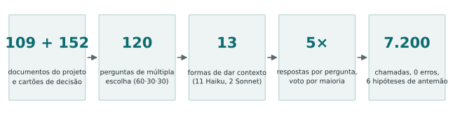
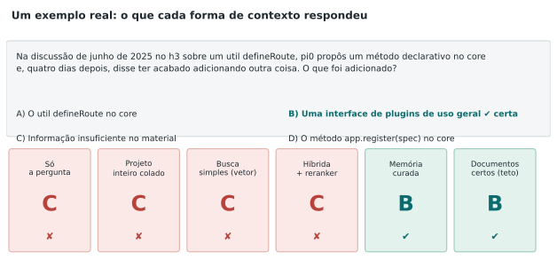
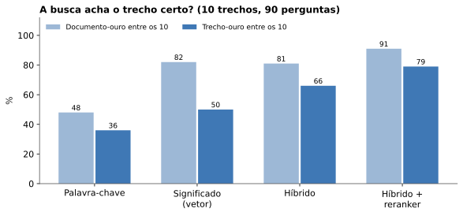
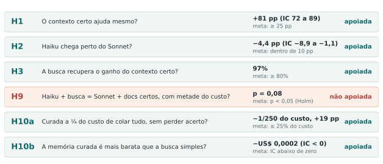
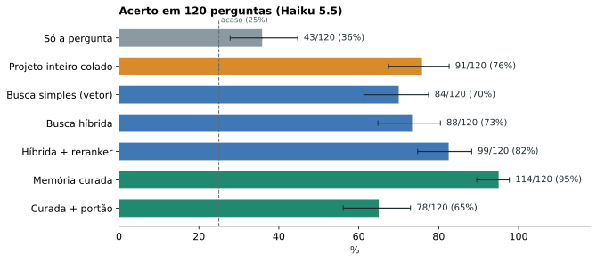
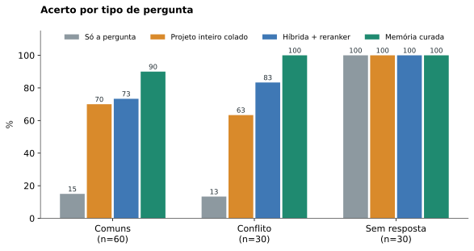
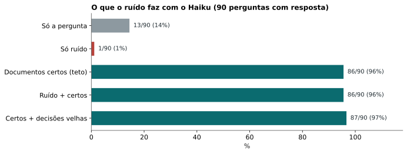
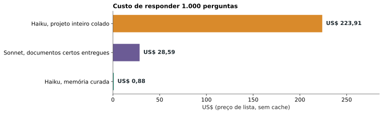

**Resumo.** Pré-registramos seis hipóteses e rodamos 7.200 chamadas, sem nenhuma falha, para medir se um modelo pequeno (Haiku 5.5), com um mini data lake de um projeto aberto, decide como um modelo maior com o contexto certo. O resultado mais forte: uma memória curada do projeto (trechos recuperados, cartões de decisão e marcação do que foi substituído) levou o Haiku a **114 acertos em 120 perguntas**, contra 43 sem contexto, 91 com o projeto inteiro colado no prompt e 99 com a melhor busca sem curadoria, a **cerca de 1/250 do custo de colar tudo**. Cinco das seis hipóteses foram apoiadas após correção de Holm; uma (H9) não foi. A principal ameaça à validade é circular e está declarada na seção 9: as perguntas foram derivadas dos mesmos cartões que a memória curada entrega. Para quem quer só o resumo prático, existe o [guia simples](/pt/rag-data-lake-haiku-guia/).

## 1. A pergunta e a decisão que ela informa

No [estudo 1](/pt/haiku-sdd-producao/), o Haiku ficou perto do Sonnet em documentos e em código com processo, por uma fração do preço. Ficou em aberto a hipótese H2: o Haiku também decide bem quando a decisão depende do histórico do projeto (por que se escolheu A e não B, o que foi substituído, o que vale hoje)? Esse tipo de pergunta é o dia a dia de quem usa agentes em um projeto longo, e a resposta orienta onde investir: em um modelo maior, em um contexto mais longo ou em recuperação e curadoria do material.

**Pergunta do estudo:** um Haiku com um mini data lake do projeto decide tão bem quanto um modelo maior com o contexto certo, e a que custo por decisão correta?

## 2. O material

### 2.1 O lake

O lake é o conjunto de material que o modelo pode consultar. Usamos o projeto aberto h3 (commit `f0e17808`), com 109 documentos de quatro origens: código, issues e pull requests, documentação e o próprio estudo 1 (protocolo, adendos, decisões). Cada documento foi dividido em trechos de até 600 caracteres, com sobreposição de 100, o que deu 1.292 trechos indexados.

Sobre os documentos construímos **152 cartões de decisão**. Um cartão é uma ficha curta com a decisão, o motivo, quando ela vale, o que ela substitui e as fontes (documento e trecho). Dos 152 cartões, 107 estão vigentes, 38 foram substituídos por outra decisão e 7 são de contexto. Um exemplo real, de uma discussão no h3:

| | Cartão antigo (substituído) | Cartão novo (vigente) |
|---|---|---|
| Decisão | pi0 propôs que o core ganhe um método declarativo `app.register(spec)`, em vez de um `defineRoute` opinativo | pi0 acabou adicionando uma interface de plugin mais genérica (#1098) no lugar do `app.register` proposto antes |
| Motivo | receio de pôr opinião demais num `defineRoute`, tornando-o menos flexível | não consta |
| Relação | é substituído pelo cartão novo | substitui o cartão antigo |

Essa estrutura é o que permite perguntar "o que vale hoje?" e não só "o que foi dito?". Os cartões foram verificados contra os documentos de origem por um script (`verificar_cartoes.py`).

### 2.2 As 120 perguntas

São 120 perguntas de múltipla escolha com quatro opções, e uma delas é sempre "Informação insuficiente no material". Três blocos:

- **60 comuns:** a resposta está em um ou poucos documentos (por exemplo, "a partir de qual versão candidata do h3 2.0.1 o `serveStatic` deixou de resolver um pathname como `//private/x`, e o que responde por padrão?").
- **30 de conflito:** existe uma decisão antiga e uma vigente. Uma das opções erradas descreve de propósito a decisão antiga, para medir se o modelo cai na armadilha do que foi superado.
- **30 sem resposta:** a pergunta parece razoável, mas o material não traz a resposta; a certa é "Informação insuficiente". Medem se o modelo inventa.

As letras das opções foram embaralhadas com semente fixa (20261109), para que a resposta certa não caia sempre na mesma posição. Um exemplo real do bloco de conflito, com a resposta de cada forma de contexto, mostra o que a rodada mede:

Nesse exemplo, quatro formas de contexto responderam C ("informação insuficiente"), e só a memória curada e os documentos certos entregues de bandeja chegaram à B. É um padrão que se repete e é discutido na seção 7.

### 2.3 O gabarito e como o validamos

O gabarito (resposta certa, opção que reflete a decisão substituída, fontes e cartões de cada pergunta) foi escrito por IA, e por isso o validamos de três formas antes da rodada:

1. **Revisão cega:** uma revisão sem acesso ao gabarito concordou em 118 das 120 na primeira passada e em 120 de 120 depois das correções. Isso mede consistência, não acurácia independente.
2. **Validação com os documentos-ouro:** o Haiku respondeu cada pergunta 5 vezes recebendo só os documentos-ouro; acertou 86 das 90 respondíveis no voto. Conferimos os quatro erros contra as fontes e o gabarito se confirmou nos quatro (um deles, a q119, é conhecimento prévio do Haiku conflitando com o material). Nenhuma pergunta foi alterada.
3. **Calibração separada:** 20 perguntas extras (6 comuns, 4 de conflito, 10 sem resposta), fora das 120, para fixar o limiar do portão de abstenção do braço A6 sem tocar nas perguntas de teste.

A mesma família de modelos escreveu e revisou o gabarito e roda os braços, o que é uma ameaça declarada na seção 9.

## 3. Os braços: o que cada um recebe e por que existe

Cada "braço" é uma forma diferente de dar contexto ao Haiku. Todos respondem às mesmas 120 perguntas, 5 vezes cada, e o resultado de cada pergunta é o voto por maioria das 5 respostas (empate pela menor letra).

| Braço | O que o Haiku recebe | A pergunta que ele responde |
|---|---|---|
| **A0** | só a pergunta | quanto ele já sabe sem o material? (linha de base) |
| **A1** | os documentos-ouro inteiros (só nas 90 respondíveis) | qual é o teto se a busca fosse perfeita? |
| **A2** | o lake inteiro (~224 mil tokens) no prompt de sistema, com cache | colar tudo resolve? quanto custa? |
| **A3** | 10 trechos mais próximos pelo significado (vetor) | a busca mais simples já basta? |
| **A4a** | 10 trechos de um híbrido: palavra-chave (BM25) + vetor, fundidos por ranking (RRF) | combinar os dois sinais ajuda? |
| **A4b** | os 30 melhores do híbrido, reordenados por um modelo reranker (bge-reranker-v2-m3) | reordenar com um modelo de leitura ajuda? |
| **A5** | os 10 trechos do A4b mais 3 cartões; quando o cartão está substituído, vem junto a decisão que o substitui; cada trecho vem etiquetado com o estado da decisão | a curadoria soma à busca? |
| **A6** | o A5 com um portão: se a nota máxima do reranker for menor que 1,05, o sistema responde "insuficiente" sem chamar o modelo | dá para economizar abstendo quando a busca não acha nada? |
| **S0 / S1** | Sonnet 5.5 sem contexto / com os documentos-ouro | e um modelo maior, na mesma situação? |
| **N1** | 10 trechos sorteados de documentos fora do ouro | o que o ruído faz sozinho? (controle negativo) |
| **N1b** | N1 e depois os documentos-ouro | o ruído atrapalha quando o ouro está presente? |
| **N2** | ouro e depois 3 trechos de decisões já substituídas | decisões velhas no contexto enganam o modelo? |

Os controles N1, N1b e N2 existem para não confundir "o contexto ajudou" com "qualquer texto no prompt ajuda". Se um texto irrelevante fizesse o Haiku acertar, o ganho dos outros braços não seria prova de nada.

## 4. As escolhas de projeto, e como as definimos antes da rodada

Antes da rodada principal fizemos um **piloto de 15 perguntas** (5 de cada bloco) para fixar os parâmetros. Todos os valores abaixo foram definidos nele e congelados no pré-registro (`prereg-rag-data-lake-haiku`).

- **Consulta de busca = só o texto da pergunta.** Não usamos as opções nem reescrevemos a pergunta; é o que um sistema real teria na mão.
- **10 trechos (k = 10).** No piloto, o Haiku com busca híbrida acertou 6 de 10 respondíveis com 3, 5, 10 ou 15 trechos, sem diferença clara, enquanto o recall do documento-ouro subia (63%, 76%, 81% e 86% para k = 3, 5, 10 e 15). Escolhemos 10 como ponto de equilíbrio entre achar o documento e não encher o prompt.
- **Trechos de 600 caracteres com sobreposição de 100**, e embeddings locais (`paraphrase-multilingual-MiniLM-L12-v2`), porque as perguntas estão em português e boa parte do lake está em inglês.
- **5 amostras por pergunta com voto por maioria**, para reduzir o ruído da resposta de um modelo sem temperatura controlável (o `claude -p` usa o padrão do harness).

### 4.1 A busca: por que o reranker entrou

Medimos o recall sobre as 90 perguntas com gabarito: o ouro estava entre os 10 trechos recuperados?

A busca só por palavra-chave foi fraca (as perguntas estão em português e o lake majoritariamente em inglês, então as palavras raramente coincidem). O vetor acha bem o documento (82%), mas raramente o trecho exato (50%). O híbrido melhora o trecho (66%), e o reranker, que lê a pergunta e cada candidato juntos, levou o trecho-ouro a 79% e o documento a 91%. Foi por isso que o A5 usa o reranker como base, escolha registrada antes da rodada.

### 4.2 O custo: como medimos

O custo nominal de cada chamada é o número de tokens multiplicado pelo **preço de lista a frio**, igual para todos os braços, para que a comparação não dependa de cache. Medimos o preço efetivo do `claude -p` em chamadas com prefixo aleatório (sem cache): Haiku US$ 0,20 por milhão de tokens de entrada e US$ 0,50 de saída (US$ 1,00 de entrada acima de 125 mil tokens); Sonnet US$ 4 e US$ 10. O gasto real com cache aparece à parte.

Isso importa no A2: colar 224 mil tokens a cada pergunta custaria US$ 0,22 por chamada (US$ 134 para as 600 chamadas). Colocamos o lake no prompt de sistema, onde o cache funciona, e rodamos a primeira chamada sozinha para aquecê-lo: o gasto real do A2 foi de cerca de US$ 7,40 no total. Descobrimos também que o cache só funciona para conteúdo do prompt de sistema, não da mensagem do usuário, o que é uma diferença declarada de montagem entre o A2 e os demais braços. Dólar de lista não é a cobrança da assinatura.

## 5. A execução

As 7.200 chamadas rodaram por `claude -p` com ferramentas desligadas e um prompt de sistema curto ("Você responde perguntas de múltipla escolha sobre decisões de projeto"), em fila: primeiro o A2, depois o Sonnet, depois os demais braços do Haiku, em cerca de 2 h 10 no total. O executor registra cada chamada com tokens, custo e a letra extraída, retoma de onde parou e recusa chamadas com zero token (sintoma de login expirado, que já nos pegou no piloto). Resultado: **7.200 de 7.200 chamadas com resposta, 0 erros, 0 respostas sem letra.**

O código, as perguntas, o gabarito, o limiar do portão e o lake foram congelados com hashes antes da rodada (tag `prereg-rag-data-lake-haiku`); os dados brutos, depois (tag `dados-rag-data-lake-haiku`).

## 6. As seis hipóteses, uma a uma

Cada hipótese foi escrita antes da rodada com métrica, limiar e critério de refutação. Os valores-p vêm de um bootstrap unilateral sobre as perguntas (10.000 réplicas): sorteamos as 120 perguntas com reposição, recalculamos a métrica e vemos em quantas réplicas o critério falha. Como são seis testes, aplicamos a correção de Holm, que torna o limite mais exigente a cada hipótese adicional.

**H1: o contexto certo ajuda mesmo?** Compara A1 (documentos-ouro) com A0 (só a pergunta) nas 90 respondíveis. Critério: pelo menos 25 pontos percentuais a mais; abaixo de 15 seria refutada. Resultado: **+81 pp** (IC 95%: 72 a 89). É o resultado esperado, mas confirma que o teste mede o que deveria: sem material o Haiku acerta só 13 das 90.

**H2: o Haiku chega perto do Sonnet?** Compara o Haiku com os documentos-ouro e o Sonnet com os mesmos documentos. Critério: o Haiku fica a no máximo 10 pp. Resultado: **−4,4 pp** (IC 95%: −8,9 a −1,1; p de Holm 0,015). O Sonnet acertou as 90; o Haiku, 86. Esta é a hipótese que fecha a H2 do estudo 1.

**H3: a busca recupera o ganho do contexto certo?** Mede quanto do ganho do oráculo (A1 sobre A0) o melhor braço com recuperação (A3, A4a, A4b ou A5, escolhido dentro de cada réplica do bootstrap, para não favorecer o vencedor) recupera. Critério: pelo menos 80%. Resultado: **97%**.

**H9: Haiku com busca iguala Sonnet com o oráculo, por metade do custo?** É a hipótese mais exigente: o melhor RAG com Haiku precisa alcançar 90% do acerto do Sonnet com o oráculo e custar no máximo 50% por decisão correta. A estimativa pontual ficou acima do critério (1,04 contra 1,00), mas a evidência estatística não passou do limite após Holm (**p = 0,08**), então **não a consideramos apoiada**. O custo, sozinho, ficou muito abaixo da metade.

**H10a: a memória curada custa um quarto do projeto colado, sem perder acerto?** Compara o custo por decisão correta do A5 com o do A2, e exige que o acerto do A5 não seja mais de 10 pp inferior. Resultado: **o A5 custa cerca de 1/250 por chamada e 1/320 por decisão correta, com 19 pp a mais de acerto** (114 contra 91). Apoiada.

**H10b: a memória curada é mais barata que a busca simples?** Compara A5 com A3 por decisão correta, em um bootstrap pareado; o intervalo de 95% precisa ficar inteiro abaixo de zero. Resultado: diferença de **−US$ 0,0002** por decisão correta (IC 95%: −0,00037 a −0,00009). Apoiada. A diferença absoluta é pequena porque as duas já custam milésimos de dólar; o que importa é que o A5 acerta mais gastando quase o mesmo.

Uma **análise de sensibilidade sem as 15 perguntas do piloto** (que ajudaram a escolher k) chega às mesmas conclusões: A5 99 de 105, H9 com p = 0,14.

## 7. Resultados

| Braço | Acertos/120 | Comum | Conflito | Sem resposta | US$ nominal por decisão correta |
|---|---|---|---|---|---|
| A0 Haiku | 43 | 9/60 | 4/30 | 30/30 | 0,00096 |
| A1 Haiku (90) | 86/90 | 57/60 | 29/30 | n.a. | 0,00154 |
| A2 lake inteiro | 91 | 42/60 | 19/30 | 30/30 | 0,295 |
| A3 vetor | 84 | 32/60 | 22/30 | 30/30 | 0,00114 |
| A4a híbrido | 88 | 38/60 | 20/30 | 30/30 | 0,00111 |
| A4b + reranker | 99 | 44/60 | 25/30 | 30/30 | 0,00096 |
| **A5 curado** | **114** | 54/60 | 30/30 | 30/30 | **0,00092** |
| A6 com portão | 78 | 30/60 | 18/30 | 30/30 | 0,00059 |
| N1 ruído | 31 | 0/60 | 1/30 | 30/30 | 0,00292 |
| N1b ruído + ouro (90) | 86/90 | 57/60 | 29/30 | n.a. | 0,00202 |
| N2 ouro + substituídas (90) | 87/90 | 59/60 | 28/30 | n.a. | 0,00168 |
| A0 Sonnet | 62 | 22/60 | 13/30 | 27/30 | 0,0114 |
| A1 Sonnet (90) | 90/90 | 60/60 | 30/30 | n.a. | 0,0286 |

### 7.1 O que deu certo

1. **O método funcionou como um teste.** Sem material o Haiku acerta 13 de 90 respondíveis (14%, abaixo do acaso de 25%); com o ouro acerta 86; o controle de ruído sozinho derruba para 1 de 90. Os controles se comportam como deveriam.
2. **A memória curada chegou perto do teto.** O A5 acertou 84 das 90 respondíveis (93%), contra 86 (96%) dos documentos-ouro entregues de bandeja, usando cerca de 4,1 mil tokens por chamada contra 224 mil do A2.
3. **No bloco de conflito, o A5 acertou 30 de 30**, contra 19 do projeto inteiro e 25 da melhor busca sem curadoria. Marcar o que foi substituído e entregar a decisão que substitui resolveu o problema que o texto cru não resolvia.
4. **Colar tudo foi pior e muito mais caro.** O A2 acertou 91 (76%) a US$ 0,22 por chamada; o A5 acertou 114 a US$ 0,0009.
5. **O reranker foi o maior ganho isolado de busca**: de 88 acertos (híbrido) para 99, e de 66% para 79% de trecho-ouro recuperado.
6. **O Haiku com o contexto certo ficou perto do Sonnet** (86 contra 90), por cerca de 1/19 do custo por chamada (US$ 0,0015 contra US$ 0,0286 por decisão correta).
7. **As respostas ficaram mais estáveis com a curadoria:** em 111 das 120 perguntas as 5 amostras do A5 concordaram integralmente, contra 80 no A2 e 104 no A4b.
8. **O custo foi medido, não suposto**, e o cache cortou o gasto real do A2 de US$ 134 de lista para cerca de US$ 7,40.

### 7.2 Como o Haiku erra

Nas 90 respondíveis, contamos o que o Haiku escolheu quando errou:

| Braço | Certo | "Informação insuficiente" | Decisão antiga | Outra |
|---|---|---|---|---|
| A0 (só a pergunta) | 13 | 73 | 1 | 3 |
| A2 (projeto inteiro) | 61 | 17 | 5 | 7 |
| A4b (híbrido + reranker) | 69 | 17 | 2 | 2 |
| **A5 (curado)** | **84** | **4** | **0** | **2** |

O erro dominante do Haiku não é inventar, e sim **abster-se quando a resposta existe**. Em 73 das 77 respostas erradas do A0 e em 17 das 29 do A2, ele escolheu "Informação insuficiente". Só 5 respostas do A2 e 2 do A4b caíram na decisão antiga, e nenhuma do A5. A curadoria atacou o erro que realmente ocorre: devolver ao modelo a confiança de que o material responde.

### 7.3 O custo por decisão

Respondendo 1.000 perguntas a preço de lista sem cache, o Haiku com o projeto inteiro colado custaria US$ 224; o Sonnet com os documentos certos, US$ 29; e o Haiku com a memória curada, menos de US$ 1. O gasto real total registrado pelo harness nas 7.200 chamadas foi de US$ 18,39, com o cache.

### 7.4 O que não funcionou, ou ficou inconclusivo

- **O portão de abstenção do A6 piorou o resultado** (78 contra 114 do A5). A ideia era economizar abstendo quando a busca não achasse nada bom; calibrado em 20 perguntas, ele abstém em muitas perguntas respondíveis e não ganha nada nas 30 sem resposta, que já eram 30/30 sem ele. Não o recomendamos como está.
- **H9 não foi apoiada** pelo critério estatístico pré-registrado (p = 0,08), embora a estimativa pontual esteja do lado certo.
- **As 30 sem resposta são fáceis** para qualquer braço: sem material, "insuficiente" é sempre a opção certa, por isso o A0 tem 30/30 nesse bloco. As comparações mais informativas usam as 90 respondíveis.

## 8. Por que esses resultados valem, e até onde

O desenho tem proteções que o estudo 1 já mostrou que importam: hipóteses, critérios e parâmetros fixados antes da rodada, controles negativos, voto de 5 amostras, correção de múltiplos testes, análise de sensibilidade sem o piloto, código e dados com hashes, e relato dos resultados negativos junto com os positivos.

## 9. Ameaças à validade

- **Circularidade das perguntas (construto).** As 90 perguntas respondíveis foram derivadas de cartões de decisão, e o cartão de origem estava entre os entregues pelo A5 em 79 delas (88%). O ganho do A5 sobre o A4b (+15 pontos) é, portanto, um **teto**, não uma estimativa para perguntas que não saíram dos cartões. Os resultados do A2, A3, A4a e A4b não têm esse problema, e o ganho do reranker vem desses braços.
- **Autoria por IA.** Lake, perguntas, gabarito e revisão vieram da mesma família de modelos que roda os braços; pontos cegos compartilhados são possíveis, e a validação com os documentos-ouro só os reduz.
- **Um projeto, múltipla escolha, 120 perguntas.** O poder detecta cerca de 14 pp no total e 25 pp por bloco de 30; diferenças menores que isso não são conclusivas.
- **Parâmetros escolhidos num piloto de 15 perguntas**, que seguem no banco (com a sensibilidade acima).
- **Temperatura não controlada** (padrão do harness) e **A2 no prompt de sistema** enquanto os outros braços usam a mensagem do usuário.
- **Peso do cache na assinatura:** a documentação não publica o peso. Depois da rodada, o uso semanal estava em 21%, mas isso inclui o restante da sessão e não isola o efeito do cache.
- **Custo de montar o lake** (escrever e verificar os cartões) não entra no custo por decisão; é estimado, não medido, e deve ser lido como ponto de equilíbrio.

## 10. O que isso permite concluir

Com segurança: o contexto certo transforma um Haiku que acerta 14% em um que acerta 96% (H1); recuperar poucos trechos com híbrido e reranker custa centenas de vezes menos que colar tudo e acerta mais; marcar decisões substituídas e entregar a que vale hoje resolve o erro típico de conflito; o ruído sozinho é pior que nenhum contexto, mas não atrapalha quando o material certo está presente. Sem segurança: quanto da vantagem da curadoria sobrevive a perguntas que não nasceram dos cartões, e se o resultado se repete em outro projeto, outro modelo ou perguntas abertas. O próximo passo natural é um banco de perguntas escrito por outra pessoa, sem acesso aos cartões, e a medição do custo de montar e manter o lake.

## 11. Reprodutibilidade

Código em `tools/rag-lake/`; perguntas, gabarito e lake em `studies/rag-data-lake-haiku/`; dados brutos em `dados/bruto/` com manifesto de hashes; figuras geradas por `studies/rag-data-lake-haiku/analise/figuras.py`. Tags `prereg-rag-data-lake-haiku` e `dados-rag-data-lake-haiku`. Análise: `python tools/rag-lake/analisar.py dados/bruto/*.jsonl --replicas 10000`. Dados, código e prompts arquivados com DOI [10.5281/zenodo.24101665](https://doi.org/10.5281/zenodo.24101665) (versão 2.0.0 do registro no Zenodo).

---
*Os experimentos, os dados e as conclusões são meus. A redação foi assistida por IA e revisada por mim.*
